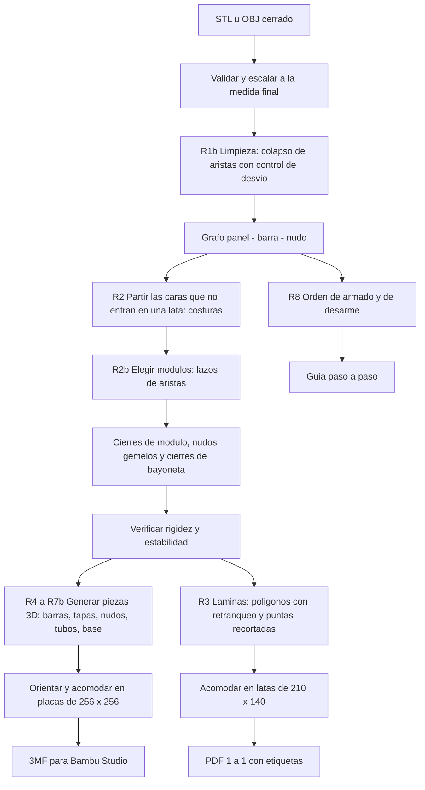
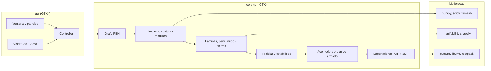
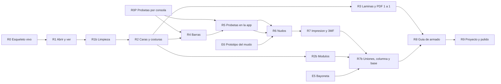

# Plan v3: aplicación Python + GTK para modelos armables en lámina de aluminio con estructura impresa en 3D

_Versión 3 (consolidada) · 2026-10-31 · nombre provisorio del proyecto: `aluarmable`._
_Reemplaza a la v1 y a su «Revisión 2». Es un documento único: no hay secciones que «manden» sobre otras._

> **Estado.** El programa todavía no se escribió. Para esta versión se hizo: (1) investigación del estado del arte, (2) mediciones sobre el perro de referencia con scripts reproducibles (Apéndice D) y (3) un **prototipo de generación (G1)** que construyó por software la estructura completa del perro para comprobar que la geometría cierra. Los números de este plan salen de ahí; lo que no se pudo medir está marcado como **«a confirmar con experimento»** y tiene su experimento en el §10.

## Contenido

0. Resumen para leer en tres minutos
1. Qué cambió en esta revisión (hallazgos y correcciones)
2. Decisiones del cliente y supuestos del analista
3. Alcance
4. El perro de referencia, medido
5. Diseño físico (barras, nudos, láminas, módulos, columna, base)
6. Algoritmos
7. Arquitectura de software y elección de bibliotecas
8. Interfaz gráfica
9. Rebanadas (slices) y orden de trabajo
10. Plan de experimentos físicos (probetas)
11. Pruebas y calidad
12. Registro de riesgos
13. Estimaciones: material, tiempo, latas, lista de compras
14. Seguridad
15. Licencias y distribución
16. Decisiones abiertas y preguntas para el cliente
17. Referencias
- Apéndices: A parámetros por defecto · B fórmulas · C glosario · D cómo se reprodujeron las mediciones

---

## 0. Resumen para leer en tres minutos

**Qué es.** Una aplicación de escritorio (Python + GTK4, Linux) que toma un modelo 3D cerrado de pocas caras (STL/OBJ) y entrega todo lo necesario para armarlo en **láminas de aluminio de lata** sostenidas por una **estructura impresa en 3D**, sin pegamento:

1. **Plantillas PDF a escala 1:1** de cada lámina, numeradas, ya acomodadas sobre «latas» para recortarlas a mano.
2. **Piezas 3D para imprimir** (barras, tapas, nudos, uniones de módulo, columna interna, base) en archivos 3MF listos para Bambu Studio.
3. **Guía de armado** paso a paso, por módulos, con orden de desarme para el transporte.

**El caso real del cliente.** Un perro golden retriever de **1 m de alto** (1,53 m de largo) en lata, que se arma y se desarma en módulos y se lleva en auto. Impresora **Bambu Lab A1**, lata de **19 × 7 cm**, filamento recomendado **PETG**.

**Cómo se resuelven los seis problemas del armado manual**

| # | Problema del cliente | Respuesta del plan |
|---|---|---|
| 1 | Todo es un solo bloque y el armado se vuelve incómodo | **8 módulos** (cabeza, torso delantero, torso trasero, 4 patas, cola) que se arman sobre la mesa y se unen al final (§5.6) |
| 2 | No tiene estructura interna: no se sostiene | **Columna interna de tubos impresos** que baja por cada pata a una base, más una malla triangulada que es rígida por geometría (§5.5) |
| 3 | Difícil de reparar | Cada lámina y cada pieza se saca y se reemplaza sola; todo está numerado (§5.4) |
| 4 | El pegamento no aguanta | **Sin pegamento**: la lámina se apoya en un escalón de la barra y una tapa a presión la aprisiona (§5.4; la variante final la deciden las probetas) |
| 5 | No se puede desarmar ni transportar | Uniones de módulo con **bayoneta de media vuelta**, en cierres repartidos por el contorno del corte (§5.6) |
| 6 | Quiere sujeción «tipo vitral» | El perfil de la barra funciona como el junquillo de un vitral: la lámina queda aprisionada entre escalón y tapa |

**Lo que dicen los números (perro a 1 m)**

- La malla original tiene **650 caras**. Con el perfil elegido, **19 % de las caras salen mal** (una barra sin tramo libre o una lámina casi tapada por las piezas). Una **limpieza automática a ~450 caras** baja eso a **2 %** moviendo la superficie, como máximo, 20 mm (promedio 2,3 mm) en un modelo de 1.000 mm. Por eso la limpieza deja de ser opcional y pasa a ser **el primer paso recomendado**.
- Con la malla limpia: **~790 barras, ~265 nudos, ~530 láminas**, que salen de **~86 latas** (73 con acomodo ideal, 147 con acomodo muy simple). Conviene juntar **100 a 150 latas**.
- Material impreso: **~3,6 kg** en barras, nudos y tapas (3,0 a 4,1 kg). Sumando las uniones de módulo, los tubos y una base, **~7 kg**.
- **Tiempo de impresión: ~200 h (140 a 300 h) para la estructura sola y ~400 h (280 a 590 h) con uniones de módulo, columna y base.** Esto **supera el rango de 180 a 270 h que el cliente aceptó**, porque aquel cálculo no incluía uniones de módulo, columna ni base. Hay palancas concretas para bajarlo a ~210–240 h (§13.2): boquilla de 0,6 mm para las piezas grandes, perfil «ligero» y base mínima.
- El perro armado pesa **~6 kg** (la lámina de lata de 0,11 mm pesa solo ~0,5 kg en total) y es **estable**: el centro de masa queda 178 mm dentro del polígono de apoyo.
- **Flexión por peso propio.** Con la malla limpia y nudos que transmiten momento, el armazón cuelga **~3 mm** como máximo (cabeza y cola). Con nudos que giran libremente cuelga **6 a 16 mm** y alguna barra larga pandearía. Con la malla original de 650 caras y nudos articulados la cabeza cuelga **más de 100 mm** en el cálculo lineal (es casi un mecanismo); **3 tirantes internos** (~50 a 90 g) lo bajan a **1 a 6 mm**. Por eso el nudo tiene que resistir el giro (se mide en E6) y la app verifica la flecha antes de generar (§5.5, §6.6).
- El **prototipo G1** generó la estructura completa (672 barras, 226 nudos) en menos de un segundo con `manifold3d`, como un único sólido válido. La geometría de la barra, los nudos y el recorte contra el modelo funcionan.

**Lo más riesgoso y cómo se ataca**

| Riesgo | Por qué importa | Cómo se ataca |
|---|---|---|
| Sujeción de la lámina (tapa a presión vs. deslizar vs. flexionar) | Es la idea central del proyecto y no se puede decidir sin imprimir con lata real | **Probetas por consola desde la semana 1**, antes de que exista la GUI (E1 a E3) |
| Diseño del nudo y «la última barra» | Si la última barra de un módulo no se puede colocar, el módulo no se arma | Prototipo físico del muslo (6 caras) con dos diseños de nudo (E6) |
| Unión de módulos con bayoneta | Los cortes no son planos ni circulares: una bayoneta que gire con el módulo no sirve | Diseño con **cierres de bayoneta repartidos por el contorno del corte**, que se accionan desde afuera (E5) |
| Tiempo de impresión | Podría duplicar lo aceptado | Medir g/h reales en la A1 (E9) y mostrar el costo en la app antes de generar |
| La lata aplanada no queda plana | Una lámina alabeada no entra pareja en la ranura | Medir el alabeo (E3) y fijar holguras y método de aplanado |

**Qué necesita el plan del cliente** (detalle en §16): conseguir y medir unas latas (alabeo y espesor), imprimir las probetas que la app generará, y confirmar tres decisiones por defecto (perfil «estándar», limpieza a ~450 caras, tiempo total).

**Cómo se avanza.** Dos pistas en paralelo: la **pista física** (probetas y prototipos que el cliente imprime desde la semana 1) y la **pista de software** en rebanadas verticales, cada una con algo visible en la GUI. El primer valor real llega con **R3**: el cliente ya puede **empezar a recortar aluminio** con las plantillas, aunque la estructura 3D todavía no exista (§9).

---

## 1. Qué cambió en esta revisión (hallazgos y correcciones)

Esta tabla resume lo que la investigación y las mediciones modificaron respecto de la v2. Las evidencias están en los apéndices y en los scripts del Apéndice D.

| # | Hallazgo | Evidencia | Qué cambia en el plan |
|---|---|---|---|
| H1 | **El nudo no es una esfera.** Con un radio de nudo por vértice (esfera que contiene todas las barras) el 22 % de las barras quedaba sin tramo libre y la masa daba 11,5 kg y 463 h, un exceso artificial. El radio que hace falta es **por barra**: depende del ángulo entre esa barra y sus vecinas. Cerca de un vértice, las raíces de las barras se **funden** en un solo cuerpo | Radio mediano por vértice 16,0 mm contra 10,9 mm por barra (W = 3,5 mm); barras con menos de 10 mm libres: 218 (22 %) contra 78 (8 %) en la malla original. G1: unión de todas las barras = un sólido válido, 9 % menos volumen que la suma de barras | Modelo de nudo = **«raíces fusionadas»** (§5.3). Los números de masa y tiempo se recalcularon con ese modelo y con el volumen real de G1 |
| H2 | **La malla de 650 caras es demasiado densa para 1 m con este perfil** | Caras que fallan (barra con < 12 mm libres o lámina visible < 25 %): 122 de 650 (19 %). Tras limpiar a 448 caras: 8 de 448 (2 %) | La **limpieza (R1b)** pasa de opcional a **paso recomendado por defecto**, con vista previa del desvío (§6.2) |
| H3 | **Los umbrales de triángulos agudos eran bajos.** Los límites fijos de ~10° y ~15° no reflejan dónde empiezan los problemas | Fallan: 12 de 18 caras con ángulo mínimo < 10°; 12/39 entre 10° y 15°; 20/61 entre 15° y 20°; 8/70 entre 20° y 25°; el resto, pocas | Los umbrales **se derivan del perfil** (ancho W del escalón) y no son ángulos fijos. La limpieza apunta a **ángulos ≥ 25°** y el recorte de punta es la regla general (§6.3) |
| H4 | **El tiempo total supera lo aceptado.** La estimación anterior (~2,7 kg, 180 a 270 h) no incluía uniones de módulo, columna ni base | Estructura sola: 3,6 kg, ~200 h (140 a 300 h). Con uniones, columna y base: ~7 kg, ~400 h (280 a 590 h). Flujo supuesto 12 a 25 g/h | Se muestra el costo en la app antes de generar. Palancas de ahorro y experimento E9 para medir en la A1 (§13.2) |
| H5 | **Error corregido en la masa de la lámina.** Un cálculo intermedio usaba 0,27 g/cm² (equivale a 1 mm de espesor) | Lámina de 0,11 mm: 0,030 g/cm² → ~0,54 kg para todo el perro; con 0,3 mm: ~1,5 kg | El perro armado pesa ~6 kg, no ~14 kg. La estabilidad no cambia (margen 178 mm, vuelco ~21°) |
| H6 | **La malla triangulada es rígida, pero «blanda» en los extremos**, y cada módulo suelto no lo es | Rango de la matriz de rigidez = 975 = 3V − 6, **0 flexiones** (modelo completo). Valor singular mínimo 0,016 contra mediana 73: los modos más blandos están en cola, patas y cabeza. Déficit por módulo: cabeza 17, torso 39, cola 5, patas 3 a 6 | Cada módulo necesita **cierre** en su corte; se validan con la matriz de rigidez (§5.5, §6.6). Los nodos de costura colineales llevan una barra virtual |
| H7 | **Los cortes de módulo no son planos ni circulares** | Planitud del lazo de corte: rms 14 a 40 mm, máx 26 a 61 mm. Lazos de corte: perímetro ~0,5 a ~1 m (cabeza, patas, cola) | Una bayoneta que gire con el módulo no es posible. Se usan **cierres de bayoneta de media vuelta repartidos por el contorno del corte**, accionados desde afuera (§5.6). La segmentación por umbrales de centroide fue solo una aproximación: el corte se elige **en la GUI** (R2b) |
| H8 | **Cantidad de latas** | Limpieza a 448 caras + costuras (78 cortes) = 526 piezas, 18.158 cm² de lámina. Latas: 73 (ideal 85 %), 86 (realista 72 %), 147 (acomodo por rectángulos) | Se muestra el rango en la app; juntar 100 a 150 latas. Acomodo por triángulos en R3 (§6.8) |
| H9 | **Prototipo G1 de generación completa** | 672 barras construidas y unidas en < 1 s; sólido válido (`manifold3d`: sin error); género 447 = E − V + 1 (coincide con la topología); 0,6 % del volumen sobresalía del modelo y se elimina intersectando con el modelo | Se adopta **perfil extruido + unión + recorte contra el modelo** como método de generación (§6.7). Se mantiene el trabajo costoso en `manifold3d` |
| H10 | **Hechos de la impresora** | Bambu Lab A1: cama 256 × 256 × 256 mm, hotend hasta 300 °C, cama hasta 100 °C, boquillas 0,2/0,4/0,6/0,8, **sin cámara cerrada** (ABS/ASA poco prácticos), caudal máximo 28 mm³/s | PETG como material recomendado. Boquilla de 0,6 mm como palanca de velocidad. PLA solo para probetas (no soporta un auto caliente) |
| H11 | **La lata aplanada puede mantener curvatura** | No medido: la lata viene de un cilindro de 70 mm de diámetro | Se agrega E3 (alabeo) y una tolerancia de lámina; la ranura debe admitir ±1 mm de alabeo (§5.4) |
| H12 | **El visor GTK4 + GL no se pudo probar en el entorno de análisis** (no hay GTK4 instalado) | — | R0 incluye el spike `GtkGLArea` y tiene plan B y C (§7.3) |
| H13 | **El armazón de barras se flexiona por su peso y eso depende de cuánto «gira» el nudo** | Cálculo de pórtico (perfil 3,5 × 5,5; E efectivo 1.000 MPa; pisadas en el suelo; ~6 kg): malla limpia con nudos rígidos, flecha máxima 2,9 mm y barra más exigida al 19 % del pandeo; con nudos articulados, 6 a 16 mm y una barra pasa el 100 %. Malla original articulada: más de 100 mm en la cabeza. 3 tirantes internos: 1 a 6 mm (tabla en §5.5) | Se agrega la **verificación de flecha por peso propio** (§6.6) con sugerencia automática de tirantes, un requisito de **rigidez de giro del nudo ≥ 10 N·m/rad** que se mide en E6, y el chequeo entra en R7b. Refuerza H2 (limpiar la malla) |

---

## 2. Decisiones del cliente y supuestos del analista

### 2.1 Decisiones del cliente (entrevista)

| Tema | Decisión |
|---|---|
| Plataforma | Python + GTK4 para Linux; repo en GitHub, código abierto, con instrucciones de instalación |
| Modelo de entrada | STL/OBJ **cerrados** de pocas caras. Referencia: **perro golden retriever** (650 triángulos). No hay editor de modelos propio |
| Superficies | Solo caras planas; sin láminas curvas |
| Lámina | **Aluminio de lata** aplanada (espesor de lámina 0,1 a 0,3 mm; la pared de la lata ronda 0,11 mm). Corte **a mano** con plantillas |
| Tamaño final | **1 m de alto** (1,53 m de largo, 439 mm de ancho) |
| Cantidad de material | Lata de **19 cm de alto × 7 cm de diámetro**; no recuerda cuántas usó en el ciervo ("muchas") |
| Caras que no entran en una lata | **Se parten** en caras más chicas (costuras internas), no se unen latas con cinta |
| Impresora | **Bambu Lab A1** (cama 256 × 256 × 256 mm, boquilla 0,4 mm); cama y boquilla configurables en perfiles de impresora |
| Tiempo de impresión | Lo estimado entonces (180 a 270 h) le pareció aceptable. **Hay que reconfirmarlo** con el nuevo número (§0, §13.2) |
| Perfil de arista | **Dos ranuras en V**, una por lámina, con el diedro exacto. La estética del perfil le da igual |
| Sujeción de la lámina sin pegamento | La deciden **las probetas** (tres variantes con lámina de lata real) |
| Unión entre módulos | **Bayoneta de media vuelta** |
| Columna interna | **Sin varilla** (no tiene): solo piezas impresas, en tramos de tubo |
| Triángulos muy agudos | **Tratamiento automático** (opción de eliminar o de recortar la punta) |
| Salidas | PDF a escala 1:1 con etiquetas y numeración; 3MF con varias piezas |
| Interfaz | Visor 3D con rotación, selección de caras y aristas con el mouse, vista de armado paso a paso y vista de plantillas 2D |
| Calibración | Probetas en la app **y** perfiles de impresora guardados |
| Forma de trabajo | Plan por **rebanadas verticales**: cada una termina con algo visible en la GUI |

### 2.2 Supuestos y valores por defecto del analista (revisables)

| # | Supuesto | Por qué | Cómo se revisa |
|---|---|---|---|
| S1 | Material: **PETG** | Resiste mejor el calor (un auto al sol llega a 50 a 95 °C) y el uso repetido de encastres; PLA se ablanda a ~60 °C | E7 (calor y fluencia) |
| S2 | Perfil «estándar»: escalón de **W = 3,5 mm** a cada lado, profundidad **H = 5,5 mm** | Es el menor que deja espacio razonable para la tapa y la patilla (§5.2) | E1 |
| S3 | Sujeción **A** (tapa a presión) como diseño inicial | Es la más reparable y no exige orden de armado | E1 |
| S4 | Nudo **N2** («cuna», se coloca de afuera hacia adentro) como diseño inicial | Evita el problema de «la última barra» (§5.3) | E6 |
| S5 | Limpieza a **~450 caras** como valor sugerido | Mejor balance entre fidelidad y fallas (§4.3) | Vista previa en R1b |
| S6 | Hoja útil de lata: **210 × 140 mm** (lata aplanada de ~220 × 150 mm) | Medición del cliente: perímetro 22 cm, alto 19 cm menos puntas curvas | Medir 5 latas (E2) |
| S7 | Lámina de **0,11 mm** (pared de lata típica 3004/3104) | Dato de la industria; el cliente debe medir la suya | Micrómetro, E2 |
| S8 | Las uniones de módulo se arman **a mano, sin herramientas** | Pedido del cliente de transportar en auto | E5 |

---

## 3. Alcance

**Dentro de la v1**
- Importar STL/OBJ cerrados; validar y reportar problemas; escalar a una medida final.
- **Limpieza** de aristas cortas y triángulos agudos con control del desvío (R1b).
- **Partir** caras que no entran en una lata (costuras) y fusión de coplanares opcional.
- **Módulos** definidos por el usuario sobre lazos de aristas (R2b).
- Plantillas PDF 1:1, acomodadas sobre latas, con cantidad de latas.
- Barras con perfil de escalón y tapa a presión, aristas cóncavas y convexas, costuras planas (diedro 180°).
- Nudos con hasta 12 barras, nudos de costura (T), cierre de módulos, uniones de módulo con **cierres de bayoneta de media vuelta**, columna interna de tubos, base.
- Verificación automática de **rigidez** y de **estabilidad** (centro de masa).
- 3MF para Bambu Studio, acomodo en placas de 256 × 256 mm, estimación de masa y tiempo.
- Probetas de calibración, perfiles de impresora, guía de armado, proyectos con deshacer/rehacer.

**Fuera de la v1** (posible en v1.x)
- Láminas curvas o plegadas; corte por CNC, plóter o láser (se exporta SVG como extra barato).
- Editor 3D propio; simplificación de mallas **densas** (más de unos miles de caras), que queda como R10.
- Reimpresión parcial automática de piezas dañadas.
- Windows y macOS.
- Pieza mayor que una lata unida con cinta de lata (el cliente lo hacía a mano; la app parte la cara).

---

## 4. El perro de referencia, medido

Todas las cifras son del archivo `obj_1_Golden_Retriever_figure_stl.stl` escalado a **1.000 mm de alto** (1.530 mm de largo, 439 mm de ancho). Los scripts están descritos en el Apéndice D.

### 4.1 Malla original

| Dato | Valor |
|---|---|
| Triángulos / aristas / vértices | **650 / 975 / 327** (cerrada, orientación coherente, Euler = 2) |
| Aristas convexas / cóncavas | 677 / 298 (31 % cóncavas): **el soporte cóncavo es obligatorio** |
| Valencia de vértice | de 3 a 12 aristas (3: 5 · 4: 26 · 5: 69 · 6: 142 · 7: 56 · 8: 23 · 9: 4 · 10: 1 · 12: 1) |
| Ángulo entre láminas vecinas | 60–90°: 23 · 90–120°: 118 · 120–150°: 268 · 150–170°: 273 · > 170°: 293. El más cerrado, **63°** |
| Ángulo mínimo entre barras en un vértice | mínimo 6,7° · p5 10,6° · p25 19° · mediana 27,2° |
| Vértices con ángulo mínimo < 15° / < 20° / < 25° / < 30° | 46 / 89 / 135 / 191 |
| Caras con un ángulo interior < 15° / < 20° / < 25° / < 30° | 57 / 118 / 188 / 283 |
| Radio inscrito de las caras | mín 4,4 mm · p5 7,0 · mediana 16,5 |
| Longitud de arista | mín 15,2 mm · p5 27,2 · mediana 73,9 · máx 270. Menores de 30 mm: 83; de 40 mm: 164; de 50 mm: 249 |
| Perfil total | 87,4 m de aristas |
| Área de caras | ~20.900 cm² (sin descontar el retranqueo de la lámina) |

La fusión de coplanares casi no sirve (597 grupos para 650 triángulos): la malla es de triángulos «de verdad».

### 4.2 Sensibilidad al tamaño final

| Alto final | Arista mediana | Aristas < 25 mm | Aristas > 200 mm | Perfil total | Fracción mediana de lámina visible* |
|---|---|---|---|---|---|
| 300 mm | 22 mm | 539 | 0 | 26 m | — |
| 500 mm | 37 mm | 249 | 0 | 44 m | 33 % |
| 700 mm | 52 mm | — | — | — | 49 % |
| 850 mm | 63 mm | — | — | — | 56 % |
| **1.000 mm (elegido)** | **74 mm** | **39** | **50 (máx 270)** | **87 m** | **62 %** |
| 1.200 mm | 89 mm | — | — | — | 68 % |

\* Calculada con el radio de nudo **por vértice**, que es pesimista (ver §5.3). Sirve para comparar tamaños entre sí. Conclusión: **por debajo de ~700 mm la malla de 650 caras ya no se puede construir con este perfil** (la lámina visible cae por debajo de la mitad); a 1 m funciona, y con limpieza funciona bien.

### 4.3 Limpieza de la malla (R1b)

Colapso de aristas por **errores cuádricos** (Garland y Heckbert, 1997) con tres controles: largo mínimo de arista, ángulo mínimo de triángulo y tolerancia de desvío; se rechaza cualquier colapso que invierta una cara, deje un triángulo casi degenerado o rompa la topología (condición de enlace). Se dejan además todas las mallas **cerradas, de Euler 2**.

| Variante (largo mín. / ángulo mín. / tolerancia) | Caras | Vértices | Aristas | Arista mediana | Caras con ángulo < 15° | < 20° | Desvío medio / p99 / máx (mm, en 1.000 mm de alto) |
|---|---|---|---|---|---|---|---|
| Original | 650 | 327 | 975 | 73,9 | 57 | 118 | — |
| 30 / 20° / 6 mm («conservadora») | 574 | 289 | 861 | 83,2 | 39 | 89 | 1,6 / 4,9 / 13,1 |
| 35 / 20° / 8 mm | 492 | 248 | 738 | 94,0 | 27 | 67 | 1,9 / 8,0 / 15,3 |
| **40 / 25° / 10 mm («equilibrada», sugerida)** | **448** | **226** | **672** | **102,2** | **23** | **52** | **2,3 / 12,0 / 20,5** |
| 45 / 25° / 12 mm («económica») | 392 | 198 | 588 | 107,0 | 12 | 32 | 3,2 / 15,1 / 22,1 |
| 50 / 30° / 14 mm | 348 | 176 | 522 | 111,7 | 9 | 24 | 4,0 / 16,7 / 26,2 |

Lectura: con la variante sugerida la superficie se mueve en promedio 2,3 mm (0,23 % del alto) y en el peor punto 20 mm (2 %), concentrado en orejas, cola y puntas de patas. **El ángulo mínimo tras limpiar sigue siendo ~8°** (algunos triángulos no se pueden colapsar sin deformar de más): esos se tratan con la regla de §6.3.

Efecto sobre la construcción (perfil estándar, W = 3,5 mm):

| Malla | Caras que fallan* | Barras con < 10 mm libres | Lámina visible mediana |
|---|---|---|---|
| Original (650) | 122 (19 %) | 78 (8 %) | 62 % |
| Conservadora (574) | 34 (6 %) | 13 (2 %) | 66 % |
| **Sugerida (448)** | **8 (2 %)** | **4 (1 %)** | **72 %** |
| Económica (392) | 4 (1 %) | 2 (0 %) | 74 % |

\* «Falla» = alguna barra de la cara queda con menos de 12 mm libres (el nudo se come la barra) o la lámina visible es menor al 25 % del área de la cara. De las 8 caras que fallan en la malla sugerida, 5 tienen ángulo mínimo < 10°: son las que elimina o recorta §6.3.

### 4.4 Caras que no entran en una lata y costuras

La hoja útil es **210 × 140 mm** (lata aplanada de ~220 × 150 mm sin las puntas curvas). Se parte por la arista más larga (se une su punto medio con el vértice opuesto) hasta que cada trozo entra girado. Cada corte es una **costura**: una arista nueva dentro de una cara plana, con diedro de 180°, que además rigidiza las caras grandes.

| Malla | Caras que no entran | Cortes | Piezas de lámina | Área total de lámina | Latas (acomodo ideal 85 % / realista 72 % / por rectángulos) |
|---|---|---|---|---|---|
| Original (650) | — | 78 | 728 | 18.194 cm² | 73 / 86 / 143 |
| **Sugerida (448)** | **56** | **78** | **526** | **18.158 cm²** | **73 / 86 / 147** |
| Económica (392) | 51 | 74 | 466 | 18.088 cm² | 72 / 85 / 149 |

El **ángulo más agudo del modelo no empeora** por cortar. Con la hoja de 220 × 150 mm (sin descontar las puntas) la cantidad de cortes baja a 56 en la malla original.

### 4.5 Inventario de piezas del perro (malla sugerida)

| Pieza | Cantidad aproximada | Observación |
|---|---|---|
| Láminas de lata | **~530** | 448 caras + 78 cortes de costura |
| Barras con tapa | **~790** | 672 aristas + ~117 aristas nuevas de costuras |
| Nudos | **~265** | 226 vértices + ~39 nudos de costura (T) |
| Tapas a presión | ~790 | una por barra |
| Uniones de módulo (radios, nudos dobles, medias barras y cierres de bayoneta) | ~180 a ~330 | 7 cortes (§5.6); depende de si cada lado lleva su propia pirámide (hasta ~150 radios y 14 apicales) |
| Tubos de columna | 15 a 20 tramos | §5.5 |
| Base | 8 a 12 placas | §5.5 |
| **Total de piezas impresas** | **~2.100** | unas **60 placas** de 256 × 256 mm |

---

## 5. Diseño físico

### 5.0 Principio de diseño

> **Todo se coloca desde afuera, nada se desliza y todo se puede sacar.**

De este principio salen las decisiones por defecto: la lámina **se apoya** en un escalón y la **tapa se presiona encima** (sujeción A); las barras **se apoyan en una cuna** del nudo, de afuera hacia adentro (nudo N2); y el armado **crece cara por cara**, como un papercraft. Así no hay un orden obligatorio de armado ni queda una «última pieza» imposible de colocar, y cualquier lámina o barra se repara quitando las tapas vecinas.

### 5.1 Las piezas

| Pieza | Para qué sirve | Se imprime |
|---|---|---|
| **Barra** | Va a lo largo de cada arista; su cara superior son dos escalones inclinados (uno por lámina) | Apoyada sobre su base plana, ranura hacia arriba: sin soportes |
| **Tapa** | Cubre el borde de las dos láminas y las retiene; una patilla con gancho entra en la ranura de la barra | A definir por E1/E4 (de pie o de costado) |
| **Nudo** | Une las barras que llegan a un vértice; tiene una cuna por barra | Con la orientación de menor voladizo (§6.7) |
| **Nudo de costura (T)** | Nudo de 3 a 4 cunas, con dos en línea recta, sobre una cara partida | Igual que el nudo |
| **Lámina** | Pieza de lata recortada a mano con la plantilla | — |
| **Radios de cierre** | Barras sin escalón que van del contorno de un corte al eje del módulo (cierran la rigidez, §5.5) | De costado |
| **Nudos dobles y cierres de bayoneta** | En cada corte de módulo: dos nudos gemelos (uno de cada módulo) y, en 3 a 6 de ellos, un cierre de media vuelta (§5.6) | Según diseño |
| **Tubos de columna** | Esqueleto interno: eje principal y una columna por pata hasta la base | De pie, a lo largo |
| **Base** | Plataforma con encastres para los pies y rieles | En placas de hasta 246 × 246 mm útiles |

Referencias visuales: el diagrama `muslo_armado.png` (sección del muslo en vista explosionada), `perfil_barra.png` (sección de la barra, abajo) y `g1_estructura_perro.png` (estructura completa generada por el prototipo G1).

### 5.2 La barra: perfil de escalón y tapa


**Forma.** En un corte perpendicular a la arista, la barra es un cuerpo con **dos escalones inclinados**, cada uno en el plano de su cara, que se juntan en la arista. Para dos láminas con ángulo φ entre sí, cada escalón tiene una pendiente β = (180° − φ)/2 respecto de la horizontal de la arista; se hunde hacia abajo en las convexas (techo) y sube en las cóncavas (valle). El ángulo entre las láminas se calcula **de la misma forma para convexas y cóncavas**: φ = 180° − (ángulo entre las normales de las dos caras).

**Parámetros** (valores iniciales; se confirman en E1):

| Parámetro | Símbolo | Valor inicial | Nota |
|---|---|---|---|
| Ancho del escalón a cada lado | W | **3,5 mm** (ligero 3,0 · robusto 5,0) | La tapa cubre el mismo ancho |
| Espesor mínimo del cuerpo bajo el escalón | H | **5,5 mm** (ligero 4,5 · robusto 7,0) | |
| Inicio de la lámina medido desde la arista | e | 1,5 mm | Deja ~3 mm de hueco entre láminas para la patilla |
| Ranura para la patilla | — | 1,4 mm de ancho × 3,6 mm de fondo | Patilla de 0,9 mm: holgura de 0,25 mm por lado |
| Espesor de la tapa | — | 1,2 mm | |
| Holgura escalón–tapa por encima de la lámina | — | 0,3 mm | La lámina queda retenida pero **libre**, ver dilatación en §5.4 |
| Solape de la lámina bajo la tapa | — | W − e = 2 mm por lado | Con corte a mano de ±1 mm queda ≥ 1 mm |

**Cómo se genera.** Se dibuja el polígono de la sección (5 vértices), se le resta la ranura y se **extruye** a lo largo de la arista; el resultado se alinea con la arista usando como «arriba» la bisectriz de las normales de las dos caras. Así se hace en G1 y alcanza una sola operación de `manifold3d` por barra. **Ángulos**: se aceptan de ~40° a 180°; 180° es la costura plana (escalones horizontales). Se avisa por debajo de 45° (el perro tiene 63° como mínimo).

**Dimensiones de impresión.** Sección de ~40 mm² (W = 3,5, H = 5,5, φ = 146°); caben 3 a 4 perímetros de 0,4 mm en cada pared. Una barra de 100 mm pesa ~4 g impresa y lleva unos 13 minutos a 18 g/h (el flujo real se mide en E9). **Largo máximo de barra**: 270 mm en el perro; entra en la A1 apoyada en diagonal (la cama mide 256 × 256 mm; la diagonal útil es ~345 mm). La partición de aristas largas en tramos con empalme queda como función para camas más chicas.

### 5.3 Los nudos

**Qué hace falta.** Cerca de un vértice, dos barras que forman un ángulo agudo θ se pisan hasta una distancia R = W / tan(θ/2) del vértice. Dentro de esa distancia las barras no pueden ser dos cuerpos separados: se **funden** en uno. Por eso el nudo es la **unión de las «raíces» de las barras** más un núcleo central, y no una esfera.

**Modelo.** Para cada extremo de barra:

- radio de raíz **Rᵢ = máx(Rmín, W / tan(θᵢ/2) + m)**, con θᵢ el menor ángulo entre esa barra y sus vecinas en ese vértice, Rmín = 7 mm y margen m = 1,5 mm;
- núcleo central de radio r₀ = 5 mm;
- **tramo libre** de la barra = largo de la arista − Rₐ − R_b.

Con W = 3,5 mm en la malla sugerida: radio de raíz mediano 10,3 mm, p90 19,3 mm, máximo 49,6 mm; tramo libre mediano 78 mm; solo 4 barras (1 %) con menos de 10 mm libres.

**Dos diseños candidatos** (se decide con el prototipo físico del muslo, E6):

| | **N1 «enchufe»** | **N2 «cuna» (diseño inicial)** |
|---|---|---|
| Cómo se une la barra | La barra termina en una espiga (~4 × 4 mm, 12 mm de largo) que **se mete en un casquillo** del nudo y se traba con un diente | La barra termina en una zapata que **se apoya de afuera** en un canal abierto del nudo y se traba con un clic; la tapa la termina de asegurar |
| Orden de armado | Obliga a deslizar cada barra en el sentido de su eje | **Sin orden obligatorio**: todo entra radialmente |
| **Última barra de un lazo** | **No entra**: los dos nudos ya están fijos y no queda juego axial. Se arregla con una barra telescópica | Entra de afuera sin problema |
| Rigidez a flexión | Buena (espiga larga) | Buena si el apoyo es ≥ 12 mm y tiene llaves antigiro (con Rmín = 7 mm ese apoyo no cabe en nudos chicos: si E6 lo confirma, Rmín sube a 12 mm para N2) |
| Impresión | Casquillos profundos: voladizos internos | Canales abiertos: menos voladizos |
| Reparación | Hay que desarmar en el sentido del eje | Se levanta la barra |

**Armado cara por cara.** Se parte de una cara (3 nudos, 3 barras, una lámina, 3 tapas) y se agrega la cara vecina que comparte una arista: aparece **un nudo nuevo y dos barras**; cuando una cara cierra un lazo, los dos nudos ya existen y **la barra entra radialmente** (por eso N2). Las láminas ya colocadas dan rigidez a lo armado, que es lo que mantiene el modelo firme mientras se arma.

**Nudos de costura (T).** En una arista larga partida, el punto medio es un nudo con 3 o 4 cunas, dos de ellas en línea recta. **Dos barras en línea recta forman una articulación de primer orden** (el nudo puede salirse de la línea sin que ninguna barra cambie de largo). La resuelve la cuna con apoyo largo y llaves antigiro (transmite momento); en la verificación de rigidez se suma una **barra virtual** entre los extremos (§6.6).

**Imprimibilidad del nudo.** Un nudo con hasta 12 brazos en direcciones 3D necesita elegir la orientación de impresión (§6.7); los que no se pueden imprimir sin soportes se marcan y se imprimen con soportes de árbol (se mide en E6 cuántos son).

### 5.4 Lámina y sujeción

**Forma de la lámina.** Es el polígono de la cara **retranqueado e = 1,5 mm de cada arista**, con las esquinas recortadas en cada nudo (chaflán de al menos el radio de raíz que corresponde) y la punta recortada cuando el triángulo es muy agudo (§6.3). La plantilla lleva número, lado exterior, flecha «arriba», cotas y una regla de 100 mm. **Tolerancia**: el diseño tolera un corte a mano de ±1 mm (el solape bajo la tapa es de 2 mm por lado). **Ojo con el lado «más grande»**: con e = 1,5 mm, una lámina cortada +1 mm de más queda a 0,5 mm de la arista y casi sin holgura con la ranura de la patilla; por eso la plantilla marca el corte **«por dentro de la línea»** y la tolerancia efectiva es de −1 / 0 mm. E1 y E2 lo confirman y, si hace falta, e sube a 2 mm. La patilla de 0,9 mm se imprime con 2 perímetros de 0,45 mm (no 3), a verificar en E4.

**Tres variantes de sujeción** (decide el cliente con probetas, E1 a E3):

| Variante | Cómo funciona | Cumple el principio (§5.0) | Cantidad de piezas | Comentario |
|---|---|---|---|---|
| **A. Tapa a presión** | La lámina se apoya en los escalones y la tapa hace clic sobre la ranura | **Sí**: todo entra de afuera | +1 tapa por barra (~790) | Más reparable; diseño inicial |
| B. Entrada lateral | La lámina desliza por una ranura antes de cerrar el nudo del extremo | No (hay que deslizar) | Mínimo | Obliga a un orden estricto; no sirve en nudos de valencia alta |
| C. Lámina flexionada | La lámina se curva un poco y entra en dos ranuras y luego en la tercera | No (se flexiona) | Mínimo | La lata puede marcarse o arrugarse |

**Retención sin apretar.** La tapa **no aprieta** la lámina: la retiene por cobertura (holgura de 0,3 mm sobre una lámina de 0,11 mm). Esto es intencional por dos razones: la lámina de lata no tolera ser apretada contra plástico (se marca) y **dilata distinto** que el plástico.

**Dilatación.** PETG se dilata unas 60 a 70 µm/m/K y el aluminio ~23 µm/m/K. En una cara de 270 mm con un salto de 40 K, la diferencia es ~0,45 mm. La lámina debe tener **holgura axial ≥ 0,5 mm por lado**, que el diseño ya da (solape de 2 mm y hueco de la ranura).

**Alabeo de la lata.** Una lata aplanada puede conservar la curvatura del cilindro (Ø 70 mm). El requisito es que la lámina apoye con un alabeo de **≤ 1 mm sobre 200 mm** tras el método de aplanado del cliente (E3). Si no se logra, la tapa lleva un pequeño resalte de presión (0,2 mm) y la lámina se alisa con rodillo.

**Criterios de aceptación de la sujeción (E1)**: la lámina soporta 5 N de tracción sin salirse, la tapa se coloca con menos de 20 N y se quita con una uña o una palanca plástica, 20 ciclos de colocar y quitar sin que la lámina se marque ni la patilla se fisure, y juego de la lámina ≤ 0,5 mm.

**Gancho de la tapa en PETG.** La deformación en la base de un gancho en voladizo es **ε = 1,5 · t · Y / (L² · Q)** (t: espesor del brazo; Y: deflexión; L: largo; Q = 1 para un caso simple) y la fuerza de empuje **P = b · t² · E · ε / (6 · L)**. Valores de partida: largo de brazo ≥ 2 a 3 veces el espesor, ≥ 3 perímetros, y la flexión en el plano de las capas. **Deformación admisible**: las tablas publicadas dan PLA 4 a 8 % y ABS 7 %, y **no dan PETG**; para PETG se parte de **3 %** (conservador) y se reduce **a la mitad si el gancho se imprime de pie**, porque en el eje Z cae la resistencia (E4 lo mide).

**Holguras para impresión** (A1, a calibrar en E1/E4): 0,2 mm para ajuste justo, 0,3 mm para encastre a presión, 0,4 mm para deslizar.

### 5.5 Rigidez, columna interna y base

**La malla es rígida por geometría.** Un modelo cerrado y triangulado de V nudos tiene **E = 3V − 6** aristas y es **isostático**: ni sobran ni faltan barras. Esto se verificó numéricamente en el perro (rango de la matriz de rigidez 975 = 3 · 327 − 6, **0 flexiones**), y vale para cualquier malla limpia (448 caras: 672 = 3 · 226 − 6). Esto es un **cálculo de barras articuladas, conservador**: los nudos reales transmiten algo de momento y las láminas, que son placas rígidas en su plano, agregan rigidez **solo si quedan trabadas**: con la holgura de §5.4 la lámina queda casi suelta, por eso **no se cuenta** como rigidez ni como margen hasta medirlo en E6.

**Pero es blanda en los extremos.** El valor singular más chico de la matriz es 0,016 contra una mediana de 73: los modos más blandos están en la punta de la cola, las patas traseras y la cabeza (las zonas más lejos del centro). La estructura necesita **columna y base** para no «bambolearse», aunque ningún mecanismo la deje deformar de verdad.

**Cuánto cuelga por su propio peso.** Para saber si esa «blandura» importa se calculó la flecha de todo el armazón con su peso. Modelo: barras de viga con el perfil estándar (sección efectiva ≈ 23 a 26 mm², I ≈ 80 mm⁴), **E efectivo 1.000 MPa** (la mitad del PETG macizo, para cubrir el relleno parcial y la anisotropía), pisadas apoyadas en el suelo, y el peso de barras, láminas, uniones y tubos repartido en los nudos (≈ 6 kg armado). Es un cálculo elástico lineal (la sección efectiva de 23 a 26 mm² es la del perfil con relleno parcial y ya incluye un descuento; sumado al E efectivo de 1.000 MPa es **doblemente prudente**, mientras que la masa de §6.6, 54 g/m, es la del perfil lleno). Los resultados son:

| Caso (perro a 1 m) | Peso modelado | Flecha máxima | Barra más exigida (pandeo de Euler) |
|---|---|---|---|
| Malla limpia (448), **nudos rígidos** | 5,7 kg | **2,9 mm** | 19 % (K = 0,7) |
| ídem, E efectivo 500 MPa | 5,7 kg | 5,7 mm | 38 % |
| ídem, perfil ligero (3,0 × 4,5) | 5,1 kg | 4,4 mm (8,8 con E 500) | 43 % (85 %) |
| ídem, perfil alto (4,0 × 8,0) | 7,1 kg | 1,5 mm | 5 % |
| ídem, aristas partidas a ≤ 200 mm (825 barras) | 6,5 kg | 2,6 mm | 7 % |
| Malla limpia, nudos con **giro parcial**: rigidez de giro 3 / 1 / 0,3 / 0,1 N·m/rad (K = 1) | 5,7 kg | 4,1 / 5,4 / 7,4 / 9,0 mm | 52 / 64 / 84 / 107 % |
| Malla limpia, nudos **articulados** (cercha) | 3,9 a 6,2 kg | 6 a 16 mm | supera 100 % en alguna barra |
| ídem, con 3 tirantes internos | 3,9 a 6,2 kg | 0,6 a 3,9 mm | ~100 % |
| **Malla original (650)**, nudos rígidos | 7,1 kg | 3,2 mm | 26 % |
| **Malla original (650)**, nudos articulados | 4,5 a 7,1 kg | **58 a 153 mm** (cabeza) | supera 100 % |
| ídem, con 3 tirantes internos | 4,5 a 7,1 kg | 1,4 a 6,3 mm | ~140 % |

*Los rangos «A a B» comparan dos versiones del cálculo con distinta masa supuesta; la variación grande de la malla original muestra que es un **índice de blandura**, no una predicción: un cálculo lineal sobre un casi-mecanismo cambia mucho con pequeños cambios de datos.*

Lectura de la tabla:

1. **Con nudos que transmiten momento, el perro se sostiene sin problema**: la flecha máxima es de ~3 mm (0,3 % de la altura) y ninguna barra pasa del 40 % del pandeo.
2. **Con nudos que giran libremente, la malla es rígida pero blanda**: 6 a 16 mm y pandeo de las barras largas. La malla **original** tiene un modo blando en la cabeza (el valor singular de 0,016 de más arriba): limpiar a 448 caras ya lo reduce unas diez veces y **3 tirantes internos** lo dejan en pocos mm.
3. **Requisito de diseño: rigidez de giro del nudo ≥ 10 N·m/rad por extremo de barra** (flecha 3,3 mm y pandeo 44 % con K = 1). A partir de ~30 N·m/rad se comporta como soldado; con 3 N·m/rad ya se llega al 52 % de pandeo (sobre el aviso del 50 %) y por debajo de ~1 N·m/rad la flecha pasa de 5 mm. Como referencia, una barra de 100 mm tiene por sí sola una rigidez de giro 4EI/L ≈ 3,2 N·m/rad. El valor real del nudo (cuna N2, con tapa) **se mide en E6**.
4. **Palancas si el chequeo falla**, en este orden: **(a) tirantes internos** (3 a 5 barras entre nudos lejanos, ~50 a 140 g, los sugiere la app); **(b) aristas más cortas** (baja el pandeo al 7 %, casi no baja la flecha y suma ~0,8 kg); **(c) perfil más alto** (1,5 mm, pero +1,4 kg); **(d) la columna interna**, que **no** se contó en este cálculo y por eso la tabla es conservadora en ese punto (y optimista en el modelo de nudo, que es lo que E6 verifica).

**Cada módulo suelto es flojo.** Un módulo abierto (una malla con un agujero de n vértices en el borde) tiene déficit de n − 3 barras. Con el corte por centroides, que fue una aproximación, el déficit es: cabeza 17, torso 39, cola 5, patas delanteras 6, patas traseras 3. **Cierre del módulo**: se agrega un nudo en el eje del corte y **un radio a cada vértice del contorno** (una «pirámide»), con lo que el módulo vuelve a ser un cuerpo cerrado e isostático. Esto se verificó numéricamente: con el cierre en cada corte, los módulos pasan de tener 3 a 17 flexiones a tener **0**. Las únicas excepciones (una flexión que quedó en las patas delanteras y en el torso) correspondían a lazos «abiertos» que produjo el corte aproximado por centroides y que no son cortes válidos; con lazos cerrados elegidos en la GUI no aparecen. Otras formas de cerrar se evalúan con la misma verificación:

| Cierre | Cuántas barras | Cuándo conviene |
|---|---|---|
| **Pirámide al eje** (radios) | n | Por defecto; el nudo del eje es además el apoyo de la columna |
| Tapa triangulada con diagonales | n − 3 | Cortes chicos (cola, patas) cuando la columna no pasa por el centro |
| Contorno rígido (nudos y barras del lazo con unión a momento) | 0 | Se comprobará en E6; sería lo ideal pero no se puede garantizar solo con el cálculo |

**Columna interna (problema 2 del cliente).** Árbol de tubos impresos que conecta los nudos del eje de cada corte: eje principal de la nuca a la cola, una columna por pata hasta el suelo, y la cabeza. Los tubos se imprimen **de pie** y se unen **encastrándose en sentido axial** al acoplar los módulos (sin girar). Dimensionado de orden de magnitud con valores típicos de PETG (E ≈ 2 GPa, fluencia ≈ 45 a 50 MPa; **verificar con el filamento real**):

| Tubo | Sección | Momento de inercia | Verificación |
|---|---|---|---|
| Patas Ø 20 × 2 mm | 113 mm² | 4.637 mm⁴ | Carga ~1,4 kg por pata. Pandeo crítico (empotrado-libre, 350 mm): ~190 N (~19 kg) → coeficiente ≥ 13 |
| **Eje principal Ø 25 × 2,5 mm** | 177 mm² | 11.321 mm⁴ | Cabeza y cuello ~1,5 kg a 0,45 m: M ≈ 6.600 N·mm → σ ≈ 7 MPa. Con un criterio de fluencia lenta de ~10 MPa (≈ 20–25 % de la fluencia a corto plazo) **pasa**; con Ø 20 × 2 mm (14 MPa) **no pasa** |

Por eso el eje principal es **Ø 25 × 2,5 mm** y las patas **Ø 20 × 2 mm**. Si más adelante el cliente consigue **varilla de aluminio o acero** de 6 a 10 mm, entra dentro del tubo como refuerzo opcional (no es necesaria). La fluencia a largo plazo se mide con un tubo cargado dos semanas (E8).

**Base.** Plataforma impresa con encastres para las 4 patas, en placas ensambladas de hasta 246 × 246 mm útiles. El polígono de apoyo de las 4 patas mide ~3.256 cm² (dentro de una caja de 439 × 883 mm). La base es **una función de R7b**: la app la dimensiona según el centro de masa y el polígono de apoyo; el costo (peso, horas) se muestra antes de generarla, porque es el componente más variable (hasta ~2 kg). Una versión **mínima** (cuatro pisadas con rieles) ahorra más de la mitad.

**Estabilidad.** (El cálculo de estabilidad usa 4,2 kg, sin uniones ni tubos; el de flecha de más arriba usa ~6 kg. En R7b se recalcula con la masa completa y se actualiza el valor de referencia de §11.) Con el modelo de masa corregido (estructura 3,6 kg y lámina de 0,11 mm: 4,2 kg), el centro de masa queda en (219; 697; 464) mm: **178 mm dentro del polígono de apoyo**, con un ángulo de vuelco de ~21°. El resultado casi no cambia con lámina de 0,3 mm (5,2 kg). Es un chequeo de «Make It Stand» (Prévost y otros, 2013) simplificado: la app avisa si el centro de masa sale del polígono o el margen es < 40 mm.

### 5.6 Módulos y uniones con bayoneta

**Módulos.** El usuario elige **lazos de aristas** que dividen el modelo; cada lazo es un **corte**. Para el perro: cabeza, torso delantero, torso trasero, cuatro patas y cola (**8 módulos**; el torso entero mide 1,19 m, por eso se parte en dos). **Decisión del cliente (2026-11-01):** con ese reparto los dos torsos miden ~760 a ~790 mm, así que el límite de transporte queda en **800 mm** (auto: Fiat Siena 4 puertas 2014; la boca del baúl no está medida: si un torso no pasa, se parte en tres, 10 módulos). `MAX_MODULE` es un parámetro y el panel de cortes avisa. Ninguna cara queda partida entre dos módulos.

**Qué se vio en los datos.** Los lazos de corte **no son planos** (planitud rms 14 a 40 mm) y **no son circulares** (por ejemplo, 463 × 336 mm en el cuello, 312 × 167 mm en una pata trasera). Por lo tanto una bayoneta «de anillo» que gire junto con el módulo **no se puede hacer**. La solución del plan:

1. **Nudos gemelos y medias barras.** En un corte, cada vértice del lazo existe **dos veces** (una por módulo). Cada arista del lazo se reemplaza por **dos medias barras** que se enfrentan por el plano de simetría del perfil: cada módulo tiene su semiperfil con su propio escalón, y cada módulo queda completo por sí solo.
2. **Posicionamiento** por clavijas cónicas entre los nudos gemelos.
3. **Cierres de bayoneta de media vuelta repartidos por el contorno**: en 3 a 6 nudos del lazo, bien separados y con lugar libre de lámina, el nudo gemelo lleva un **anillo giratorio** con dos ranuras en J y el otro lleva dos orejas. Se acciona **desde afuera** con la mano, media vuelta. Se eligen los nudos con más espacio libre; los cierres periféricos, lejos del eje, resisten mejor la flexión que uno central.
4. **Tubos de columna** que se encastran axialmente al acoplar (no giran).
5. **Radios al eje** que cierran la rigidez (§5.5).

**Alternativa** si E5 muestra que los cierres periféricos no alcanzan: una tuerca de bayoneta central sobre un acoplamiento circular en el eje; tiene el defecto de que, una vez acoplados los módulos, el anillo queda adentro y hay que girarlo antes del último contacto.

**Parámetros iniciales de la bayoneta** (a calibrar en E5): orejas de 4 mm de espesor; ranura en J de 4,4 mm de ancho (holgura 0,2 mm por lado); recorrido axial 8 mm; rampa de 5° para precarga; resalte de retención de 0,4 mm; giro de 180°.

**Cantidades (perro, 7 cortes).** ~74 vértices de contorno, unos 30 cierres, ~74 radios, 15 a 20 tramos de tubo. Se estiman en ~0,8 kg y ~45 h.

### 5.7 Material, calor y seguridad térmica

- **PETG** como material de la estructura (PLA solo para probetas y prototipos). La A1 imprime PLA, PETG y TPU; **no tiene cámara cerrada**, así que ABS y ASA no son prácticos.
- Un auto al sol llega a 50–95 °C en el interior: PLA (vítreo ~60 °C) se deforma; PETG (transición vítrea ~80 °C, deflexión bajo carga ~70 °C) **no** cubre el peor caso (95 °C) con carga; sin carga y a la sombra sí. Conviene **transportar a la sombra** y no dejar el modelo cargado en una posición apoyada. Se prueba en E7.
- **Boquilla de 0,6 mm** para barras gruesas, nudos, tubos y base (más rápida); **0,4 mm** para tapas, patillas y cierres.
- **Capas** de 0,16 a 0,20 mm, 3 a 4 perímetros, relleno 15–20 %, sin soportes salvo los nudos marcados.

---

## 6. Algoritmos

### 6.0 Visión general



Una sola fuente de verdad: **el grafo panel–barra–nudo**. De él salen las plantillas, las piezas, la verificación y la guía de armado; así el PDF y las piezas 3D no pueden divergir (riesgo 9 de la v1).

### 6.1 Modelo de datos: grafo panel–barra–nudo (PBN)

| Elemento | Campos principales |
|---|---|
| **Nudo** | id, posición, tipo (`vértice`, `costura-T`, `gemelo-A/B`, `eje`), barras incidentes, radio de raíz por barra |
| **Barra** | id, nudos (a, b), paneles (p1, p2), φ, convexa/cóncava, largo, tipo (`arista`, `costura`, `media-barra`, `radio`, `tubo`), módulo, tramo libre |
| **Panel** | id, plano, polígono 3D (los nudos, **incluyendo nudos T**), polígono de lámina 2D, módulo, etiqueta (`F123`, `F123-a`) |
| **Módulo** | id, nombre, paneles, cortes (lazos), eje, nudo apical |
| **Proyecto** | malla (ruta y hash), escala, parámetros, perfil de impresora, decisiones del usuario (cortes, módulos, tratamientos de triángulos) |

**Invariantes** que se prueban en CI: cada barra tiene exactamente 2 paneles (salvo radios y tubos); Euler = 2 en la malla cerrada; los nudos T son colineales dentro de una tolerancia; los IDs son **estables** (se asignan por orden lexicográfico de las posiciones cuantizadas a 0,1 mm, así que recargar el modelo no renumera). Archivo `.aluarm` en JSON versionado (`"formato": "aluarm-1"`) con migraciones.

### 6.2 Limpieza de la malla (R1b)

**Método.** Colapso de aristas por errores cuádricos (Garland y Heckbert, 1997), ajustado para este problema:

1. Cada vértice recibe un **cuádrico** (suma de los cuádricos de los planos de sus caras).
2. **Candidatas**: aristas más cortas que `Lmín`, y para cada triángulo con ángulo mínimo menor a `ángmín`, su arista más corta. Prioridad: primero las más cortas respecto del umbral y los ángulos más agudos.
3. Para cada candidata se prueban tres posiciones (un extremo, el otro, el punto medio) y se elige la de menor error; se acepta si el **error RMS ≤ `tol`**.
4. Se **rechaza** el colapso si: no cumple la condición de enlace (rompería la topología), da vuelta una cara (producto de normales < 0,6), deja un triángulo con menos del 15 % del área original, o crea un triángulo con ángulo mínimo menor que `mín(10°, el que tenía)`.
5. Se repite hasta que no haya más colapsos posibles.
6. Se informa el **desvío** (distancia entre superficies muestreadas, en ambos sentidos): media, p99 y máximo.

**Por qué no solo decimar.** La decimación por cuádricos sola deja triángulos muy agudos; los controles de ángulo y de largo mínimo son los que cambian el resultado (el ángulo mínimo sube de 6,7° a 8,3° y la cantidad de caras con ángulo < 15° baja de 57 a 23). Para mallas **densas** (R10) se usa antes `fast-simplification` (QEM en C++) y después este paso.

**En la GUI.** Tres controles (largo mínimo, ángulo mínimo, tolerancia), tres juegos predefinidos (conservadora, equilibrada, económica) y una **vista previa** con el desvío en colores. El valor sugerido es la «equilibrada» (§4.3).

### 6.3 Triángulos agudos: reglas derivadas del perfil

El cliente decidió que el tratamiento sea **automático**. Los umbrales de 10° y 15° de la v2 eran bajos: las mediciones mostraron que los problemas empiezan en 20° a 25° (§1, H3). Ahora los umbrales **se derivan de W** y no son ángulos fijos.


Para cada cara se calcula el radio inscrito ρ, el ángulo mínimo α y el tramo libre de sus tres barras. Entonces:

| Caso | Condición | Tratamiento |
|---|---|---|
| **A. Eliminar** | ρ ≤ W + 2 mm (no queda lámina visible) **o** alguna barra queda con menos de 12 mm libres | Colapsar su arista más corta (dentro de la tolerancia de §6.2). Si no es posible, se avisa y el usuario decide |
| **B. Recortar la punta** | α < 25° | La lámina se corta en el punto donde el triángulo mide **8 mm de ancho**; el resto de la punta queda tapado por el nudo |
| Normal | el resto | Sin cambios |

**Por qué recortar la punta casi no cambia el aspecto.** La raíz del nudo ocupa ya R = W/tan(α/2) + 1,5 mm desde el vértice, y el punto donde el triángulo mide 8 mm de ancho está a d = 8/(2·tan(α/2)). Las dos distancias casi coinciden (W = 3,5 mm):

| α | Raíz del nudo R | Punta recortada hasta d |
|---|---|---|
| 10° | 41,5 mm | 45,7 mm |
| 15° | 28,1 mm | 30,4 mm |
| 20° | 21,3 mm | 22,7 mm |
| 25° | 17,3 mm | 18,0 mm |
| 30° | 14,6 mm | 14,9 mm |

Es decir, la zona recortada ya estaba ocupada por la raíz del nudo. Las láminas con puntas de 8 mm de ancho se cortan a mano sin dificultad. **El usuario puede cambiar el tratamiento de cada triángulo.** Todos los umbrales son parámetros.

### 6.4 Partición de caras grandes (costuras)

1. Para cada cara se calcula el rectángulo mínimo girado (barrido de 1°) y se compara con la hoja útil (210 × 140 mm).
2. Si no entra, se **corta por la arista más larga**: se une su punto medio con el vértice opuesto; se repite en los trozos hasta que todos entran.
3. Cada corte crea **una barra de costura** (diedro 180°) y un **nudo T** en el punto medio; la cara vecina conserva su lámina de una pieza y solo gana un nudo en medio de uno de sus lados.
4. **Preferencia** (parámetro): por la arista más larga (por defecto), por el diedro menos visible, o a mano.
5. Se numeran `F123-a`, `F123-b`. Medido: **ningún corte empeora el ángulo más agudo del modelo**.

### 6.5 Módulos: elegir los lazos de corte (R2b)

Un **corte** es un ciclo cerrado de aristas. Tres formas de elegirlo en la GUI:

1. **Clic en vértices**: el usuario marca puntos y la app traza el camino más corto por aristas (con vista previa).
2. **Plano**: se mueve un plano sobre el modelo; la app propone el ciclo de aristas más cercano al plano (ciclo de menor suma de distancias al plano).
3. **Pintar**: se pintan caras como módulo y el borde es el corte.

**Ayuda automática (opcional).** «Sugerir cortes»: busca mínimos locales del perímetro de la sección a lo largo de los ejes principales (cuellos, nacimiento de patas y cola). Es una ayuda: el usuario ajusta. La literatura sobre partición de modelos grandes en piezas imprimibles (Chopper, Luo y otros, 2012) resuelve un problema parecido con otras restricciones; aquí los cortes **siguen aristas**, tienen que cerrar un lazo, y el tamaño máximo es el del baúl del auto (~600 mm), no el de la cama.

**Controles de cada corte** (se muestran en un panel): **radio libre ≥ 16 mm** alrededor de cada nudo de cierre (anillo Ø 22 mm más orejas de 4 mm) y **barrido de colisión** de cada módulo a lo largo del eje de acople, que debe ser común a todos los cierres del corte (recorrido axial de 8 mm); cantidad de vértices del lazo (aviso si > 24), perímetro, planitud, tamaño de cada módulo, **cantidad de nudos disponibles para cierre de bayoneta** (≥ 3, con ≥ 12 mm libres de lámina y bien separados), y que el nudo del eje caiga dentro del modelo.

**Salida**: nudos gemelos, medias barras, nudo apical en el eje (centroide del lazo, normal del plano ajustado) y radios (§5.6).

### 6.6 Verificación de rigidez y estabilidad

**Rigidez.** Matriz de rigidez R de E filas × 3V columnas (una fila por barra); rango por **descomposición en valores singulares** (`numpy`). Flexiones infinitesimales = 3V − 6 − rango. Los **valores singulares más bajos** indican los modos blandos y se muestran sobre el modelo en colores. Tratamientos:

- nudos T colineales → **barra virtual** entre los extremos de la arista partida;
- módulo suelto → se cuenta el **déficit N − 3h** (N: vértices de todos los lazos de borde; h: cantidad de lazos) y se prueba cada cierre de §5.5; el nudo apical no recibe más de **10 radios** (si el lazo tiene más vértices, se reparten en varios apicales unidos por el tubo, o se usa la tapa triangulada);
- se informa si el modelo completo o algún módulo con su cierre tiene flexiones.

`PyRigi` (Gallet, Grasegger, Himmelmann y Legerský, 2025) es un paquete de Python para rigidez de marcos de barras y nudos, con funciones centrales descriptas en el plano; **no se usa en el núcleo** (el cálculo 3D es de unas 30 líneas con `numpy`) y queda como contraste opcional en las pruebas.

**Estabilidad.** Masa de cada elemento (barras por largo, nudos por radio, láminas por área y espesor), **centro de masa** y **polígono de apoyo** (envolvente convexa de las pisadas); se informa el margen y el ángulo de vuelco, y se avisa si el margen es < 40 mm.

**Flecha por peso propio y tirantes (R7b).** Modelo de **pórtico 3D**: una viga por arista (matriz de 12 × 12 por barra, `scipy.sparse`), con el perfil y el E efectivo de los parámetros; carga = masa de cada nudo por g (barras por largo, láminas por área, uniones y tubos); apoyos verticales en los nudos con z < 40 mm y tres grados de libertad más para fijar el cuerpo rígido. La **rigidez de giro del nudo** es un parámetro (resorte rotacional en cada extremo, eliminado por condensación estática) y se toma de E6. Salidas: **flecha máxima** y su nudo, y **uso de pandeo de Euler** de cada barra (K = 0,7 con nudo rígido, 1 con nudo articulado), que se pintan sobre el modelo. Aviso si la flecha pasa de **5 mm** (0,5 % de la altura) o el uso de pandeo pasa del **50 %**.

Si hay aviso, la app propone **tirantes**: barras interiores entre dos nudos existentes **del mismo módulo**, sin lámina (perfil sencillo, ~54 g/m). Candidatos: pares de nudos no vecinos a 150 a 450 mm cuyo segmento queda dentro del modelo (muestreo de 5 puntos con `trimesh`); en cada paso se agrega el que más baja la flecha (búsqueda voraz); se sugieren 3 a 5. Un tirante se **coloca durante el armado**, cuando el módulo todavía tiene caras abiertas (la guía de §6.9 lo ubica antes de las últimas láminas), y se descarta si su montaje exigiría pasar por una cara ya cerrada o si queda a menos de 15 mm del eje de un tubo. Con la malla limpia, el cálculo tarda segundos.

**Resistencia de la columna.** Para cada tubo: pandeo de Euler con la carga soportada y flexión con el momento de la cabeza, contra un valor admisible de fluencia lenta (§5.5).

### 6.7 Generación de piezas (barras, nudos, cierres)

Todo sobre `manifold3d` (booleanas con garantía de sólido válido) y secciones 2D con `CrossSection`:

1. **Barra**: polígono de la sección (§5.2) − ranura → `extrude(largo)` → `transform` a la posición y orientación de la arista. En G1, **672 barras se construyeron y unieron en menos de 1 s**; el sólido resultante es válido y su género (447) coincide con E − V + 1.
2. **Nudo**: unión del núcleo y de las **raíces** de las barras que llegan (cada una es la misma sección extruida Rᵢ), menos las cunas con la holgura de encastre (`CrossSection.offset`).
3. **Recorte contra el modelo**: cada pieza se **intersecta con el volumen del modelo** para quitar las puntas de escalón que asoman donde las caras forman ángulos agudos. En G1 asomaba el **0,6 %** del volumen (16 cm³ de 2.612 cm³, en 306 trocitos); la intersección lo elimina.
4. **Tapa**: banda de ancho 1,2 mm desplazada del escalón (`offset_curve` con unión en inglete) + patilla con gancho, extruida el largo libre menos 8 mm.
5. **Cierres de bayoneta, nudos gemelos, radios**: según §5.6.
6. **Texto en relieve** (0,4 mm) con las etiquetas, con contornos de fuentes (`fontTools` o `matplotlib.TextPath`) pasados a `CrossSection`; se puede apagar.
7. **Validación de cada pieza**: sólido válido, volumen positivo, ninguna medida mínima por debajo de 0,8 mm (erosión de 0,4 mm sin que la pieza desaparezca), cabe en la placa.

**Orientación de impresión.** Barras: apoyadas en la base plana. Tapas: la que decidan E1/E4. Nudos y cierres: se prueban unas 200 direcciones (esfera de Fibonacci más las direcciones de las caras de la envolvente) y se elige la de menor área en voladizo (> 45° respecto de la vertical) y mayor área de apoyo. Los nudos que quedan con voladizos grandes se marcan «con soportes» (en el 3MF se activan los soportes de árbol del slicer para ese objeto).

**Coordenadas.** Las piezas se generan en **coordenadas locales** (origen en la pieza) y solo se mueven al armar el 3MF, para que la precisión de punto flotante no dependa de la posición en el modelo (1,5 m).

### 6.8 Acomodo

**Láminas sobre latas (2D).**
- Se parte de empaque por rectángulos (`rectpack`, MaxRects) como base y se mejora con un acomodo **por triángulos** (rotaciones libres, separación mínima de 3 mm para poder cortar a mano). Objetivo: **72 % de aprovechamiento** (~86 latas) frente a 147 latas por rectángulos.
- Opciones para el acomodo por polígonos: `nest2D` (libnest2d; licencia a verificar, de tipo GPL, y solo código fuente en PyPI, por lo que se evalúa aparte), o una heurística propia: unir pares de triángulos por su lado largo para formar paralelogramos y empaquetarlos.
- Opcional (R10): **acomodo para tijera**, con cortes rectos que atraviesan toda la hoja, que son más rápidos de cortar a mano.
- Cada «lata» sale como una página del PDF con el contorno, las piezas numeradas, las marcas de corte y la regla de 100 mm.

**Piezas sobre placas (3D).**
- Huella de cada pieza en su orientación; empaque por rectángulos más huella convexa con `shapely`; varias placas de **246 × 246 mm útiles**.
- Se agrupan por **módulo** y se limita el **tiempo por placa** (por defecto 10 h, para impresiones nocturnas); la app muestra la suma de tiempos y de gramos.

### 6.9 Orden de armado y de desarme (R8)

- **Tirantes**: si la verificación de §6.6 los pidió, se colocan dentro de cada módulo **antes de las últimas dos láminas**, desde la cara que todavía está abierta.
- **Entre módulos**: árbol de acople (torso delantero como raíz; patas y torso trasero; luego cabeza y cola). El desarme es el orden inverso y la guía indica **qué cierres girar**.
- **Dentro de un módulo**: crecimiento **cara por cara** desde una cara de partida (elegida por el usuario o la más cercana al suelo). En cada paso se agrega una cara vecina de lo ya armado; se prefieren las que comparten **dos o más aristas** (cierran lazos al final). Cada paso lista: nudos nuevos, barras (con su cuna), lámina y tapas.
- El orden se valida: cada paso comparte al menos una arista con lo armado y ninguna barra necesita deslizarse en sentido axial.

### 6.10 Etiquetas y PDF

- **Esquema**: módulo (`C` cabeza, `T1` y `T2` torso, `P1` a `P4` patas, `R` cola), caras `F###` (con `-a`, `-b` al partir), barras `E###`, nudos `V###`.
- **PDF 1:1** con `pycairo` (ya viene con GTK): páginas A4 o Carta; cada lámina con su número, el lado exterior, la flecha «arriba», las cotas, el **color de su módulo** y una **regla de 100 mm** que se mide al imprimir. El PDF de latas muestra el **acomodo** de §6.8.

### 6.11 Exportación a 3MF

- **Núcleo del formato** (3MF estándar): un archivo ZIP con `[Content_Types].xml`, `_rels/.rels` y `3D/3dmodel.model` (un `<object>` por pieza, nombre = etiqueta, unidades en mm, un `<item>` por pieza con su transformación sobre la placa).
- **Extensiones de Bambu Studio**: `Metadata/model_settings.config` (bloques de placa con `plater_id` y `plater_name`, y los objetos con su `name`), `Metadata/project_settings.config` (`printer_model`, boquilla, filamento) y miniaturas. La documentación pública no describe cómo generar un 3MF de Bambu desde cero; hay que **parchear `printer_model`** si el archivo viene de otra impresora.
- **Estrategia en dos pasos**: **(A, segura)** un 3MF de núcleo estándar **por placa**; el cliente lo abre en Bambu Studio y elige su perfil. **(B, cómoda)** un solo 3MF de varias placas, **tomando como plantilla un proyecto vacío que el cliente guarda una vez desde su propio Bambu Studio para la A1** (así los metadatos son válidos). Se prueba en E9.
- **Reproducibilidad**: piezas ordenadas, fechas fijas en el ZIP; el 3MF se relee con `lib3mf` y `trimesh` en las pruebas.

### 6.12 Tolerancias y rendimiento

- Una única clase `Tolerancias` (longitud, ángulo, planitud, holguras); nada de epsilons sueltos.
- Los cálculos pesados (limpieza, generación, acomodo, 3MF) corren en un **hilo aparte** con barra de progreso y botón de cancelar; los resultados se guardan en caché por (parámetros, forma de la pieza) porque muchas barras repiten sección y largo.
- Medido en el análisis: la estructura completa del perro (672 barras) se genera en menos de 1 s; la limpieza del prototipo en Python puro, sin optimizar, tarda del orden de segundos a un minuto en 650 caras (con cola de prioridad en producción será menor).

---

## 7. Arquitectura de software y elección de bibliotecas

### 7.1 Estructura del repositorio

```
aluarmable/
  core/                      # sin GTK: se prueba en consola
    mesh_io.py               # carga STL/OBJ (trimesh), validación, escala
    cleanup.py               # R1b: colapso de aristas con control de desvío
    pbn.py                   # grafo panel-barra-nudo, IDs estables, invariantes
    seams.py                 # partición de caras grandes (costuras)
    modules.py               # lazos de corte, nudos gemelos, cierres, radios
    sharp.py                 # reglas de triángulos agudos (derivadas de W)
    sheets.py                # polígono de lámina (retranqueo, chaflanes, puntas)
    profile.py               # sección de barra, tapa, ranura
    node.py                  # nudos (estrategias N1 / N2), nudos T, raíces fusionadas
    lock.py                  # cierres de bayoneta, medias barras
    column.py                # tubos y base
    rigidity.py              # matriz de rigidez, flexiones, estabilidad, pandeo
    orient.py                # orientación de impresión
    nesting.py               # latas (2D) y placas (3D)
    assembly.py              # orden de armado y de desarme
    export_pdf.py            # plantillas 1:1 (pycairo)
    export_3mf.py            # 3MF (núcleo + metadatos de Bambu Studio)
    probes.py                # probetas de calibración (también por consola)
    estimate.py              # masa, tiempo, latas
    params.py                # dataclasses de parámetros y perfiles de impresora
    project.py               # .aluarm (JSON versionado) y migraciones
  gui/
    app.py, window.py        # Gtk.Application / ApplicationWindow
    viewer.py                # GtkGLArea: cámara, dibujo, selección por color
    panels/                  # modelo, limpieza, caras, módulos, láminas, estructura, calibración, impresión, armado
    controller.py            # lógica sin widgets (se prueba con escena falsa)
  cli.py                     # modo consola con los mismos pasos
tests/  docs/  examples/  tools/   # tools/: scripts de medición del Apéndice D
```

### 7.2 Principios

- **El núcleo no importa GTK.** El `Controller` expone acciones (`abrir`, `limpiar`, `partir_caras`, `definir_corte`, `generar`…) y eventos; la GUI solo los muestra.
- **Estrategias intercambiables** para lo que se decide con probetas: `SheetFix` (A, B, C), `NodeStyle` (N1, N2), `LockStyle` (periférico, central). Cambiar de variante no toca el resto.
- **Un solo grafo** (§6.1) como fuente de las plantillas, las piezas y la guía.
- **Núcleo puro y determinista**: mismas entradas, mismos archivos (RNF4).
- **Unidades**: milímetros; una clase `Tolerancias`; piezas generadas en coordenadas locales.
- **Trabajo pesado en hilos** con cancelación; resultados en caché por (parámetros, forma).
- **Comandos con deshacer/rehacer** para todo cambio del usuario (patrón comando).



### 7.3 Decisiones de stack, con alternativas

Versiones comprobadas en el entorno de análisis (Python 3.13, `pip`): `manifold3d` 3.5.4, `lib3mf` 2.5.0, `trimesh` 5.2.0, `numpy` 2.5.3, `scipy` 1.18.1, `shapely` 2.2.0, `rectpack` 0.2.2, `fast-simplification` 0.2.0. El requisito del proyecto es **Python ≥ 3.11**.

| Tema | Elección | Alternativas consideradas | Por qué |
|---|---|---|---|
| Interfaz | **GTK4 + PyGObject** (la rama estable al investigar era la 4.22) | Qt (PySide6) | Decisión del cliente; integra bien con Linux. PyGObject se instala por paquetes de la distribución, no con `pip` |
| Visor 3D | **`Gtk.GLArea`** con **`moderngl`** o **`PyOpenGL`** (se decide en el spike de R0) | `pyrender`, `vtk`, WebKitGTK con three.js, dibujo por software en `DrawingArea` | `GLArea` es la forma nativa de GTK4. `moderngl` ofrece una API más simple y puede tomar el contexto actual; hay un hilo del foro de GNOME sobre el uso con GTK4 y un ejemplo para GTK3 en el repositorio de `moderngl` (§17). **No se pudo probar aquí** (no hay GTK4 instalado) |
| Núcleo geométrico 3D | **`manifold3d`** (Apache-2.0) | `build123d`/`CadQuery` (OpenCascade), booleanas de `trimesh` | Garantiza sólidos válidos, es muy rápido (672 barras en < 1 s) y trae secciones 2D (`CrossSection`: `offset`, `extrude`, `revolve`). OpenCascade da redondeos exactos pero es pesado y lento; se reserva para piezas puntuales si hiciera falta |
| Polígonos 2D | **`shapely`** (GEOS) y `CrossSection` | `pyclipper` | Retranqueos, huellas, acomodo |
| Mallas | **`trimesh` + `numpy` + `scipy`** | `open3d`, `pyvista` | Decisión del cliente; livianos |
| Simplificación de mallas densas (R10) | `fast-simplification` + el paso de §6.2 | `pymeshlab`, `open3d` | QEM en C++, rápido; la parte de ángulos es propia |
| Acomodo 2D | `rectpack` y heurística de triángulos; `nest2D` a evaluar | `pynest`, SVGnest | `rectpack` es suficiente para empezar; la licencia de `nest2D` se verifica |
| PDF | **`pycairo`** | `reportlab` | Ya viene con el entorno de GTK |
| 3MF | **escritor propio** (`zipfile` + XML) y `lib3mf` para **verificar** | solo `lib3mf` | Los metadatos de Bambu Studio no están en la especificación estándar (§6.11) |
| Texto en relieve | `fontTools` / `matplotlib.TextPath` | — | Contornos de fuentes a polígonos |
| Pruebas | `pytest`, `xvfb-run` para la GUI, `hypothesis` para propiedades | — | §11 |
| Estilo y tipos | `ruff`, `mypy` (opcional) | — | — |
| Empaquetado | `pyproject.toml` + `uv` o `venv --system-site-packages`; luego **Flatpak** | AppImage | El runtime de GNOME ya incluye GTK4 |

**Spike de R0 (visor).** Qué se verifica, en este orden: (1) `GLArea` con OpenGL 3.3 y búfer de profundidad, sin error en `realize`; (2) **el framebuffer de GTK no es el 0**: con `moderngl` hay que tomar el framebuffer activo (`detect_framebuffer`) en cada `render`; con `PyOpenGL` basta dibujar; (3) redimensionado sin cierres; (4) selección por color en un framebuffer fuera de pantalla; (5) X11 y Wayland, con Mesa (y NVIDIA si el cliente la tiene); (6) CI con `xvfb` + Mesa por software. **Plan B**: `PyOpenGL` puro. **Plan C**: dibujo por software (`cairo`, orden de fondo a frente) en un `DrawingArea`, lento pero funciona en cualquier máquina y en CI.

### 7.4 Instalación

- Paquetes de la distribución: `python3-gi`, `gir1.2-gtk-4.0` (o equivalentes), `python3-cairo`.
- Resto con `pip`/`uv` dentro de un `venv --system-site-packages`.
- Scripts de instalación probados en Ubuntu LTS y Fedora; documentados en el README (R9). Flatpak como objetivo posterior.

---

## 8. Interfaz gráfica

**Ventana**: visor 3D a la izquierda (siempre visible), panel de pestañas a la derecha, barra inferior con el **costo previo** (piezas, gramos, horas, latas) que se actualiza al cambiar parámetros.

**Visor**
- Órbita, paneo y zoom con el mouse; atajos de teclado para vistas (frente, lado, arriba).
- **Selección** de caras, aristas, nudos y módulos (por color).
- Colorear por: módulo, ángulo entre láminas (convexa/cóncava), problemas (caras que fallan), grosor de barra.
- Láminas **semitransparentes**; **vista explosionada** por módulo; plano de corte.
- Modo «armado»: lo ya armado en color, lo que falta en gris, lo que se coloca en este paso resaltado.

**Pestañas** (una por tipo de tarea, en el orden del trabajo)

| Pestaña | Contenido | Rebanada |
|---|---|---|
| Modelo | abrir, tamaño final (mm), tabla de mediciones en vivo | R1 |
| Limpieza | controles y vista previa del desvío, lista de triángulos agudos | R1b |
| Caras | caras, costuras (ver y mover cortes), fusión opcional | R2 |
| Módulos | cortes, módulos con color, controles de cada corte | R2b |
| Láminas | cada lámina en 2D, acomodo en latas, cantidad de latas, PDF | R3 |
| Estructura | barras, nudos, cierres; sección 2D de la barra; chequeos | R4, R6, R7b |
| Calibración | probetas y perfiles de impresora | R5 |
| Impresión | placas, tiempo y gramos, 3MF | R7 |
| Armado | guía paso a paso y orden de desarme | R8 |

**Costo previo (barra inferior).** Antes de generar nada, la app muestra una estimación con rangos: número de piezas, masa de filamento, horas (según el flujo calibrado en E9), latas. Es la respuesta al riesgo de «¿cuánto me va a costar esto?» y evita sorpresas como la de §1, H4.

**Mensajes**: en castellano sencillo, con el motivo y qué hacer; sin trazas técnicas en pantalla (van a un registro). La interfaz usa `gettext` desde el principio; el inglés es posterior.

**Accesibilidad básica**: todo accesible por teclado, contraste suficiente, tamaños de fuente del sistema.

---

## 9. Rebanadas (slices) y orden de trabajo

### 9.1 Principio y excepción

Cada rebanada atraviesa todas las capas (geometría → lógica → GUI) y termina con algo **visible y usable en la interfaz**, con una demostración al cliente. **Hay una excepción deliberada**: la **pista física** (probetas y prototipos que el cliente imprime) empieza **antes** que la GUI, porque lo más riesgoso del proyecto no es de software (§12) y no se puede resolver sentado frente a la pantalla.

### 9.2 Orden y dependencias



### 9.3 Cuadro de rebanadas

Esfuerzo orientativo en **semanas de trabajo dedicado** de una persona (S = 1, M = 2, L = 3 a 4, XL = 5 a 6); es un orden de magnitud para planificar, no un compromiso.

| Rebanada | Qué se ve en la GUI | Esfuerzo | Riesgo que cierra |
|---|---|---|---|
| **R0P** (pista física, semana 1) | Nada (archivos para imprimir): el cliente imprime las probetas **E1 a E4 y, en cuanto existan, E5, E6 y E9** (el script también genera el muslo con N1/N2, los cierres y las placas de medición) | S | Sujeción de la lámina; ranura y gancho en PETG |
| **R0** Esqueleto vivo | Ventana con un cubo que gira; spike del visor | S | Visor GL dentro de GTK4 |
| **R1** Abrir y ver | «Abrir…»; sombreado con aristas; tamaño final; tabla de mediciones; **costo previo** | M | Validación de mallas |
| **R1b** Limpieza | Controles con vista previa del desvío; lista de caras que fallan | M | Malla demasiado densa (H2) |
| **R2** Caras y costuras | Caras de colores, selección con mouse, costuras con vista previa, IDs estables | M | Caras que no entran en lata |
| **R2b** Módulos | Cortes por lazos, módulos de color, vista explosionada, chequeo de cada corte | L | Segmentación en módulos (H7) |
| **R3** Láminas y PDF | Cada lámina en 2D; acomodo en latas; PDF 1:1; cantidad de latas | L | **Primer valor real**: el cliente puede empezar a cortar |
| **R4** Barras | Perfil de cada arista, sección 2D, STL de una barra; todas las barras del perro generadas | L | Perfil correcto en convexas, cóncavas y costuras |
| **R5** Probetas y perfiles | Pestaña «Calibración»: elegir variante A/B/C y holguras; perfil de la A1 | M | **Decisión de sujeción** |
| **R6** Nudos | Estructura completa ensamblada con láminas semitransparentes; chequeo de interferencias | L | Nudo y «última barra»; nudos con soportes |
| **R7** Impresión y 3MF | Placas, gramos, horas; 3MF que abre en Bambu Studio | L | 3MF válido; tiempo real |
| **R7b** Uniones, columna y base | Cierres de bayoneta, radios, tubos y base; chequeo de estabilidad y de flecha | XL | Transporte y rigidez |
| **R8** Guía de armado | Paso a paso por módulo; orden de desarme | M | Armado sin ayuda externa |
| **R9** Proyecto y pulido | `.aluarm`, deshacer/rehacer, informe de validación, empaquetado | M | Instalación y mantenimiento |
| **R10** (opcional) | Mallas densas, SVG/DXF, acomodo para tijera, nudo N1, aristas largas con empalme | — | — |

**Total orientativo**: ~39 semanas de trabajo dedicado (unos 9 meses a tiempo completo); la pista física avanza en paralelo. **Hitos para el cliente**: (M1) tras **R3** puede cortar **10 a 20 láminas de prueba** (E2); el corte masivo (~530 láminas) se autoriza **recién con E1 y E6 aprobados**, porque W, e y los radios de raíz de las plantillas dependen de esos resultados, y cada plantilla lleva impresa la **versión de parámetros** con la que se generó; (M2) tras **R5** ya decidió la sujeción y tiene su perfil de impresora; (M3) tras **R7** imprime estructura; (M4) tras **R7b** y **R8** arma un perro completo; (M5) tras **R9** puede instalarlo cualquiera.

### 9.4 Detalle de cada rebanada

**R0P. Probetas por consola (semana 1, antes que la GUI).**
- *Se entrega*: `aluarmable-probes`, un script que genera STL/3MF para la A1 de las probetas E1 a E4 (sujeción A, B y C; ganchos de tapa en dos orientaciones; escalera de holguras) y, en una segunda entrega, las de E5 (cierre de bayoneta), E6 (muslo con nudos N1 y N2, y la pieza de medición de rigidez de giro) y E9 (placas de 40 barras, 40 tapas y 10 nudos). Usa el mismo `profile.py`, el mismo generador de piezas (versión mínima de `node.py` y `lock.py`) y **un `export_3mf` mínimo** (3MF estándar por placa) que luego crecen dentro de R6, R7 y R7b. E2 usa una plantilla de triángulos en un PDF mínimo (`pycairo`), no la rebanada R3.
- *Aceptación*: el cliente imprime, prueba con lata real y responde los criterios de §10. Los resultados cambian parámetros por defecto del plan.
- *Nota*: es la única rebanada sin GUI; existe para decidir lo más riesgoso lo antes posible.

**R0. Esqueleto vivo.**
- *Se ve*: ventana GTK4 con `GtkGLArea` y un cubo que gira con el mouse (órbita y zoom).
- *Debajo*: estructura del repositorio, `pyproject`, `ruff`, `pytest`, CI con `xvfb`, **spike** de §7.3, decisión `moderngl` vs `PyOpenGL`.
- *Aceptación*: arranca en Linux con las instrucciones del README; prueba de humo; el spike documenta qué funcionó en X11 y Wayland.

**R1. Abrir y ver un modelo.**
- *Se ve*: «Abrir…» carga un STL/OBJ; sombreado con aristas; panel con nombre, triángulos y dimensiones; campo **tamaño final**; **tabla de mediciones en vivo** con lo que ya se puede calcular (triángulos, aristas, ángulos, dimensiones, volumen y masa aproximada); el **costo previo** completo (latas, gramos, horas) y «caras que fallan» aparecen cuando existen sus módulos: costuras (R2), acomodo (R3), raíces de nudo (R6) y estimador (R7).
- *Debajo*: `mesh_io` (validación: cerrado, degenerados, orientación, componentes), escala.
- *Aceptación*: cubo, tetraedro, icosaedro y el perro abren; una malla abierta o rota muestra un aviso entendible.

**R1b. Limpieza.**
- *Se ve*: controles (largo, ángulo, tolerancia), juegos predefinidos, vista previa con el desvío en colores, lista de triángulos agudos y de caras que fallan (en R1b se calculan con el modelo de raíz **simplificado** de §6.3 —radio por barra y tramo libre—, que luego reemplaza `node.py` en R6).
- *Debajo*: `cleanup`, `sharp`, informe de desvío.
- *Aceptación*: el perro con la variante «equilibrada» da **448 caras (±10 %)**, cerrado y de Euler 2, con desvío medio ≤ 3 mm y máximo ≤ 25 mm; las caras que fallan bajan de ~19 % a ≤ 3 %.

**R2. Caras y costuras.**
- *Se ve*: caras de colores, clic para seleccionar (ID, área, lados), costuras propuestas con vista previa (mover o anular), fusión de coplanares opcional.
- *Debajo*: grafo PBN, `seams`, selección por color, IDs estables.
- *Aceptación*: icosaedro 20 caras; cubo 6 (con fusión); perro: ~78 cortes con hoja de 210 × 140 mm; IDs idénticos al recargar.

**R2b. Módulos.**
- *Se ve*: elegir cortes (por vértices, por plano o pintando); lista de módulos con color; vista explosionada; panel de chequeos de cada corte.
- *Debajo*: `modules`, `rigidity` (déficit y cierre).
- *Aceptación*: el perro se divide en **8 módulos** con lazos cerrados, ninguno de más de ~600 mm, cada uno con **0 flexiones** al cerrarlo.

**R3. Láminas y plantillas PDF.**
- *Se ve*: cada lámina en 2D con medidas, número, color de módulo; acomodo sobre latas; **cantidad de latas**; «Exportar PDF 1:1».
- *Debajo*: `sheets` (retranqueo, chaflanes, puntas), `nesting` 2D, `export_pdf`.
- *Aceptación*: impreso al 100 %, la regla mide 100 ± 0,5 mm; el cliente recorta **10 láminas** y comprueba medidas (E2); aprovechamiento ≥ 70 % o aviso.
- *Con esto el cliente puede cortar láminas de prueba* (hito M1); el corte masivo espera a E1 y E6.

**R4. Barras.**
- *Se ve*: pestaña «Estructura»: aristas como sólidos; clic en una arista muestra diedro, largo y la sección 2D; exportar STL.
- *Debajo*: `profile`, extrusión con `manifold3d`, validación (pared mínima, ranura mínima), costuras de 180°.
- *Aceptación*: diedros del cubo (90°) y del tetraedro (≈ 70,5°) con ±0,5°; las 672 barras del perro son sólidos válidos en < 5 s; el recorte contra el modelo deja la parte que asoma en 0.

**R5. Probetas y perfiles de impresora.**
- *Se ve*: pestaña «Calibración»: elegir rango de holguras y espesor de lámina, vista previa de las probetas, exportar 3MF; editor del perfil (A1 por defecto: cama, boquilla, holguras).
- *Debajo*: `probes` (la del R0P, ahora con GUI), `params` y perfiles en `~/.config`.
- *Aceptación (cliente)*: elige la variante A, B o C y las holguras ganadoras; quedan guardadas en su perfil.

**R6. Nudos.**
- *Se ve*: estructura completa ensamblada con láminas semitransparentes; clic en un nudo muestra valencia, radios de raíz y ángulos.
- *Debajo*: `node` (N2 y estrategia N1), nudos T, raíces fusionadas, chequeo de interferencias, orientación de impresión.
- *Aceptación*: sólidos platónicos y el muslo (6 caras) sin interferencias; los 265 nudos del perro válidos; informe de cuántos necesitan soporte; holgura mínima ≥ la del perfil.

**R7. Impresión y 3MF.**
- *Se ve*: la cama con las piezas acomodadas, lista de placas, gramos y horas, aviso de piezas con soporte; «Exportar 3MF».
- *Debajo*: `nesting` 3D, `export_3mf`, `estimate`.
- *Aceptación*: el 3MF abre en **Bambu Studio** con cada pieza nombrada; la estimación de tiempo queda a ±25 % de lo medido en E9.

**R7b. Uniones de módulo, columna y base.**
- *Se ve*: cierres de bayoneta en los cortes, radios, tubos y base; chequeo de estabilidad con margen y ángulo de vuelco; **mapa de flecha por peso propio** y barras con riesgo de pandeo, con los tirantes sugeridos.
- *Debajo*: `lock`, `column`, `rigidity` (pandeo, flexión, apoyo, flecha por peso propio y tirantes).
- *Aceptación*: una pata unida al torso (físicamente) con 50 ciclos de colocar y quitar; margen de estabilidad ≥ 40 mm; flecha calculada ≤ 5 mm (o tirantes aceptados por el usuario); costo (kg y horas) mostrado antes de generar.

**R8. Guía de armado.**
- *Se ve*: «anterior/siguiente»; en cada paso se resaltan las piezas con su etiqueta; modo despiece; **orden de desarme** para transportar.
- *Debajo*: `assembly`, lista de piezas y cantidades por módulo.
- *Aceptación*: el cliente arma un módulo completo (la pata trasera) sin apoyo externo siguiendo la guía.

**R9. Proyecto, deshacer y pulido.**
- *Se ve*: guardar y abrir `.aluarm`, deshacer/rehacer, informe de validación, preferencias, mensajes amigables.
- *Debajo*: `project` con migraciones, historial de comandos, empaquetado.
- *Aceptación*: los proyectos viejos cargan al subir la versión del formato; instalación documentada en dos distribuciones; README y manual corto.

---

## 10. Plan de experimentos físicos (probetas y prototipos)

**Para qué sirve.** Lo más riesgoso del proyecto es físico (sujeción de la lámina, nudo, bayoneta, calor, tiempo real). Cada experimento tiene una pregunta, un procedimiento corto, un **criterio de aprobado** y la **decisión que habilita**. Los resultados se anotan en una tabla del repositorio (`docs/experimentos.md`) y cambian los parámetros por defecto.

**Material común**: PETG, Bambu Lab A1, boquilla 0,4 mm, capas 0,16 mm, 3 a 4 perímetros, lata real aplanada; balanza de cocina (g), calibre o micrómetro (0,01 mm), pesas o dinamómetro, guantes anticorte. Cada probeta se diseña para imprimirse en **menos de 2 horas**.

| # | Pregunta | Qué se imprime y cómo se prueba | Aprobado si… | Decide | Antes de |
|---|---|---|---|---|---|
| **E1** | ¿Qué variante sujeta mejor la lámina de lata real: A (tapa), B (entrada lateral) o C (flexionada)? | 5 tiras de 100 mm por variante, con perfil convexo (146°), cóncavo (146°) y cerrado (100°); trozos de lata de 40 × 100 mm | Soporta 5 N de tracción sin salirse; la tapa se coloca con < 20 N y se quita con una palanca plástica; 20 ciclos sin marcar la lámina ni fisurar la patilla; juego de la lámina ≤ 0,5 mm | Variante A, B o C; valores de W, H, ranura y holgura | R4, R5 |
| **E2** | ¿Cuánto mide de verdad la lata y qué precisión da el corte a mano? | Medir 5 latas (espesor, perímetro, alto útil); recortar **10 triángulos** con la plantilla impresa en 3 tamaños y medir | Espesor 0,10 a 0,13 mm; 90 % de los lados dentro de ±1 mm; tiempo por lámina registrado | Hoja útil (210 × 140), espesor, retranqueo e y solape | R3 |
| **E3** | ¿Queda plana la lata aplanada? | Aplanar con 2 o 3 métodos (rodillo, prensa entre tablas, martillo de goma) y medir el alabeo apoyando sobre un vidrio | Alabeo ≤ 1 mm sobre 200 mm | Método de aplanado; si hace falta, resalte de presión en la tapa | R4 |
| **E4** | ¿Cómo debe ser el gancho de la tapa en PETG? | Ganchos con espesor 0,8 / 1,0 / 1,2 mm, largo 3 / 4 mm, **de pie y de costado**, holgura 0,2 / 0,3 mm | Sin fisuras en 50 acoples; fuerza de acople 5 a 20 N; fuerza de extracción 5 a 20 N | Geometría de la patilla, orientación de impresión, deformación admisible en PETG | R4 |
| **E5** | ¿Sirve la bayoneta de media vuelta repartida por el contorno? | Dos nudos gemelos con cierre (anillo giratorio Ø 18 / 22 / 26 mm, ranura en J de 4,4 mm) y una prueba de 3 cierres sobre un lazo de 300 mm | 100 ciclos sin desgaste visible; juego axial ≤ 0,5 mm; se acciona con la mano; **no se afloja tras 10 minutos de traqueteo en el baúl del auto** | Cierre periférico o central; dimensiones del cierre | R7b |
| **E6** | ¿Qué nudo conviene: N1 (enchufe) o N2 (cuna)? ¿Entra la última barra? | **Muslo del perro (6 caras alrededor de un nudo, 7 nudos, 12 barras, 6 láminas)** impreso con N1 y con N2; armado con láminas reales. **Rigidez de giro**: un tramo de barra de 40 mm sale del nudo; se carga con 5 N en la punta y se mide el desplazamiento con calibre (k = F · L² / (δ − δ_barra), donde δ_barra es la flexión del mismo tramo empotrado en una morsa) | Armado en < 20 min; la última barra del lazo entra; flexión ≤ 2 mm al empujar 5 N en el nudo más lejano; reemplazar una lámina y una barra en < 5 min; se registra cuántos nudos necesitan soportes; **rigidez de giro del nudo k ≥ 10 N·m/rad** (10.000 N·mm/rad) | N1 o N2; Rmín; llaves antigiro; cuántos nudos van con soporte | R6 |
| **E7** | ¿Aguanta el calor de un auto? | Barras y nudos de PETG (y una muestra de PLA para contraste) con 200 g colgados a 100 mm del apoyo de una barra de 150 mm, a **80 °C** durante 2 h (horno con termómetro) | Deformación permanente ≤ 0,3 mm en PETG; si no cumple, el transporte exige sombra o ventilación y se registra la temperatura máxima tolerada | Material (PETG), reglas de transporte | R7 |
| **E8** | ¿Resiste el tubo de la columna la carga continua? | Tubo Ø 25 × 2,5 mm armado con **dos tramos encastrados de ≤ 240 mm** (altura útil de la A1 con el tubo de pie) hasta 450 mm, en voladizo con 1,5 kg en la punta; medir la flecha a 0, 1, 7 y 14 días | Flecha inicial dentro de +30 % de la elástica calculada (P·L³/3EI ≈ 20 mm con E = 2 GPa; el encastre suma holgura); aumento entre el día 1 y el 14 ≤ 25 % y velocidad decreciente. **El resultado fija el E efectivo y si el tubo aporta rigidez o solo soporta** | Diámetro y pared del eje; si hace falta, varilla | R7b |
| **E9** | ¿Cuánto tarda y pesa de verdad? ¿Abre el 3MF en Bambu Studio? | 1 placa de 40 barras, 1 de 40 tapas y 1 de 10 nudos, con boquilla 0,4 y con 0,6 mm; abrir el 3MF (estrategias A y B de §6.11) | Estimación dentro de ±25 % de lo medido; la 0,6 mm es ≥ 1,5 veces más rápida en barras y nudos con calidad aceptable; el 3MF abre con las piezas nombradas | Constantes del estimador (g/h); uso de la boquilla de 0,6; formato 3MF | R7 |
| **E10** | ¿Funciona todo junto? | **Un módulo completo** (una pata trasera con su cierre) unido a un trozo de torso, con lámina, tapas, tubo y cierres | Se arma siguiendo la guía en un tiempo razonable (≤ 4 h); 50 ciclos de desarme y armado; estable sobre la base | **Ir/no ir** a imprimir el perro completo | R8 |

**Puerta antes de imprimir el perro completo.** Solo se empieza la impresión grande si **E1 a E9 están aprobados (E7 y E8 con sus plazos) y E10 se completó**; E2 y E3 deben estar listos antes del corte masivo de láminas. Así el riesgo de imprimir 400 horas de piezas inservibles se acota a unas decenas de horas de probetas.

**Cómo se registran**: fecha, impresora y filamento, parámetros usados, resultado de cada criterio, foto, y qué valor del plan se cambió.

---

## 11. Pruebas y calidad

| Nivel | Qué se prueba | Herramienta |
|---|---|---|
| Núcleo | Modelos sintéticos (cubo, tetraedro, prisma triangular, octaedro, icosaedro, dodecaedro truncado) con valores esperados: caras, aristas, diedros, áreas de lámina, rigidez | `pytest` |
| Propiedades | Sobre poliedros convexos aleatorios: cada pieza es un sólido válido de volumen positivo, sin interpenetración entre barra y nudo, holgura mínima ≥ la del perfil, IDs estables, E = 3V − 6 y 0 flexiones | `hypothesis` |
| Regresión | **Valores dorados** del perro (tabla de abajo) y de otros 2 modelos | `pytest` con tolerancias |
| Exportación | El 3MF se relee (cantidad de objetos, volumen por pieza); el PDF se rasteriza a 100 ppp y se mide la regla de 100 mm y el tamaño de página | `lib3mf`, `trimesh`, `pycairo` |
| GUI | Lógica del `Controller` con escena falsa; arranque de la ventana en CI | `xvfb-run` |
| Rendimiento | Generar la estructura del perro en < 5 s; limpiar en < 30 s | prueba con tope de tiempo |
| Calidad | Estilo y tipos; cobertura ≥ 80 % del núcleo | `ruff`, `mypy`, `coverage` |
| Físico | Experimentos E1 a E10 (§10) | cliente |

**CI** en GitHub Actions: Ubuntu (con los paquetes de GTK) y Python 3.11 a 3.13; los PDF y 3MF generados se guardan como artefactos para revisión visual.

**Valores dorados medidos en esta revisión** (se convierten en pruebas, con la tolerancia indicada):

| Prueba | Valor medido | Tolerancia |
|---|---|---|
| Malla original: triángulos / aristas / vértices | 650 / 975 / 327 | exacto |
| Rango de la matriz de rigidez de la malla original | 975, 0 flexiones | exacto |
| Limpieza «equilibrada»: caras / vértices / aristas | 448 / 226 / 672 | ±10 % |
| Desvío de esa limpieza (media / p99 / máx, mm) | 2,3 / 12,0 / 20,5 | ±25 % |
| Caras que fallan con W = 3,5 mm (malla limpia) | 8 (2 %) | ≤ 3 % |
| Costuras con hoja de 210 × 140 mm | 78 cortes, 526 láminas | ±5 % |
| Unión de las 672 barras: género y volumen | 447; 2.612 cm³ | exacto; ±2 % |
| Volumen que asoma fuera del modelo antes del recorte | 16,2 cm³ (0,6 %) | ≤ 1 % |
| Centro de masa y margen de apoyo | (219; 697; 464) mm; margen 178 mm | ±10 mm |
| Flecha por peso propio, malla limpia, nudos rígidos (E efectivo 1.000 MPa) | 2,9 mm; barra más exigida 19 % | ±30 % |
| Tirantes: flecha de la malla limpia con nudos articulados, sin / con 3 tirantes | 16,0 mm / 3,9 mm | ±30 %; la mejora es de al menos 3 veces |

---

## 12. Registro de riesgos

Probabilidad (P) e impacto (I): B = baja, M = media, A = alta.

| # | Riesgo | P | I | Mitigación | Plan B | Dónde se cierra |
|---|---|---|---|---|---|---|
| 1 | La sujeción A (tapa) marca o deja salir la lámina de lata real | M | A | Probeta con lata real antes de la GUI; holgura de 0,3 mm; alabeo medido | Variante B con orden estricto, o C; en último caso, puntos de adhesivo de contacto | E1, R0P |
| 2 | Visor `GtkGLArea` inestable o incompatible | M | M | Spike de R0 en X11, Wayland y Mesa | `PyOpenGL` puro; dibujo por software en `DrawingArea` | R0 |
| 3 | La ranura (1,4 mm) o la patilla (0,9 mm) no imprimen bien con boquilla de 0,4 mm | M | A | Orientación con la ranura hacia arriba; compensación XY de la A1 (±0,15 mm) | Ranura más ancha; piezas con boquilla de 0,2 mm; tapa de dos piezas | E1, E4 |
| 4 | El gancho de la tapa se rompe por las capas de impresión | M | M | Orientación de capas a lo largo del gancho; espesor ≥ 1,0 mm; radio de acuerdo | Tapa deslizante (cola de milano) o pasador de lámina | E4 |
| 5 | El nudo no es rígido o la última barra no entra | M | A | Diseño N2 (todo entra desde afuera); apoyos largos con llaves antigiro | N1 con barra telescópica | E6, R6 |
| 6 | Demasiados nudos necesitan soportes (tiempo, calidad) | M | M | Búsqueda de orientación; radios cortos | Partir el nudo en dos mitades planas | E6, R6 |
| 7 | **El tiempo total (~400 h) excede lo aceptado** | A | M | Costo previo en la app; boquilla de 0,6 mm; perfil ligero; base mínima; imprimir por módulos | Menos caras (malla «económica», 392) | E9, R7 |
| 8 | La lata aplanada queda alabeada | M | M | Medir (E3); método de aplanado; resalte de presión | Más ancho de solape; rodillo | E3 |
| 9 | El corte a mano es impreciso | M | B | Tolerancia de ±1 mm; plantillas con marcas de corte | Plantillas de cartón rígido; plóter de corte (no probado con lata) | E2 |
| 10 | Un corte de módulo no cierra, es muy grande o tiene pocos nudos para cierre | M | M | Panel de chequeo por corte; ayuda de sugerencias | Cortes por plano con ajuste manual | R2b |
| 11 | Los cierres periféricos no resisten o se aflojan en el viaje | M | A | Dos o más cierres de seguridad; resalte de retención | Tuerca central; pasador adicional | E5, R7b |
| 12 | Falta rigidez: el armazón cuelga por su peso (cabeza, cola, puntas de patas) o las barras largas pandean, sobre todo si el nudo gira libremente | M | M | Limpieza de la malla; nudo con rigidez de giro ≥ 10 N·m/rad (E6); verificación de flecha y pandeo (§6.6); columna y radios | Tirantes internos sugeridos por la app (3 a 5); aristas más cortas; perfil más alto | E6, R7b |
| 13 | Fluencia del PETG bajo carga continua (tubos, base) | M | M | Tubo de Ø 25 × 2,5 mm; criterio de ~10 MPa | Varilla de aluminio o acero dentro del tubo | E8 |
| 14 | El auto caliente deforma las piezas | M | M | PETG; transporte a la sombra y sin carga apoyada | Material de mayor temperatura en otra impresora | E7 |
| 15 | Booleanas inestables o piezas no estancas | B | M | `manifold3d`; construir secciones 2D y extruir; pruebas de propiedades | Reparar con `trimesh` | R4 |
| 16 | El 3MF no abre bien en Bambu Studio | M | M | Estrategia A (3MF estándar por placa); plantilla del cliente para la B | Exportar STL por pieza | E9, R7 |
| 17 | Divergencia entre PDF y piezas 3D | B | A | Una sola fuente de parámetros (el grafo); prueba que compara la lámina con el perfil | — | R3, R4 |
| 18 | Acomodo de láminas poco eficiente (147 en vez de 86 latas) | M | B | Heurística por triángulos; el rango se muestra | `nest2D` si la licencia lo permite | R3 |
| 19 | Alcance excesivo para una persona | A | A | Rebanadas con demo; lo opcional en R10; pista física en paralelo | Recortar a un modelo de tamaño intermedio | todas |
| 20 | Cuesta juntar 100 a 150 latas | M | B | Avisar la cantidad desde R1; permitir hojas más chicas | Comprar chapa fina de aluminio | R1 |
| 21 | Bordes cortantes de la lata | A | M | Guantes; bordes cubiertos por la tapa; limado | — | §14 |
| 22 | Licencias de dependencias incompatibles | B | M | Revisar antes de agregar; evitar GPL en el núcleo si se elige licencia permisiva | Heurística propia | R9 |
| 23 | Cambios de API en `manifold3d` o `trimesh` | B | M | Versiones fijadas y CI | — | R0 |
| 24 | Mallas de entrada abiertas, con huecos o gigantes | M | M | Validación con mensajes claros; R10 para mallas densas | Reparar fuera de la app | R1 |
| 25 | Tolerancias de la A1 (±0,15 mm) mayores que las holguras | M | M | Compensación XY y escalera de holguras | Holguras de 0,4 mm | E1 |
| 26 | El cliente no puede imprimir las probetas a tiempo | A | M | Probetas de < 2 h; secuencia propuesta por prioridad | El analista ajusta el plan con lo disponible | E1 a E10 |
| 27 | El modelo se vuelca por golpe o viento | B | M | Base con apoyos; margen ≥ 40 mm | Lastre en la base | R7b |
| 28 | La mano de lata hace que el modelo quede visualmente irregular | B | B | Plantillas y tolerancias; vista previa | — | E2 |

---

## 13. Estimaciones

### 13.1 Inventario (perro a 1 m, malla de 448 caras)

Ver §4.5: **~530 láminas, ~790 barras con tapa, ~265 nudos, ~180 piezas de unión, 15–20 tubos y 8–12 placas de base, unos 2.100 piezas impresas en ~60 placas** de 256 × 256 mm.

### 13.2 Masa y tiempo de impresión

**Estructura** (barras + nudos + tapas, PETG 1,27 g/cm³). Se midió en el prototipo G1 el volumen sólido de barras y nudos (2.612 cm³, +8 % por costuras) y se multiplicó por la fracción impresa (perímetros + relleno: **0,60 a 0,90, central 0,75**); las tapas se estimaron aparte (~700 cm³ con costuras).

| Perfil | Masa de la estructura | Rango (fracción 0,60 a 0,90) |
|---|---|---|
| **Estándar** (W = 3,5; H = 5,5) | **3,6 kg** | 3,0 a 4,1 kg |
| Ligero (W = 3,0; H = 4,5) | ~2,8 kg | — |

**Extras** (estimación de orden de magnitud): uniones de módulo ~0,8 kg; tubos ~0,7 kg; **base ~2 kg (completa)** o ~1 kg (mínima). Una base completa es la parte más incierta y más variable.

**Flujo supuesto** (promedio real de una pieza pequeña, mucho menor que el máximo teórico): **12 / 18 / 25 g/h** (pesimista / central / optimista). La A1 admite hasta 28 mm³/s (~127 g/h de PETG a flujo máximo), pero las piezas chicas, las capas cortas y los viajes bajan mucho el promedio. **Se mide en E9.**

| Escenario | Qué incluye | Masa | Horas (12 / 18 / 25 g/h) |
|---|---|---|---|
| Solo estructura (estándar, 0,4 mm) | barras + nudos + tapas | 3,6 kg | 298 / **199** / 143 |
| **A. Base completa** (estándar, 0,4 mm) | + uniones 0,8 + tubos 0,7 + base 2,0 | **7,1 kg** | 592 / **395** / 284 |
| **B. Recomendado**: estándar, base mínima, boquilla 0,6 mm en piezas grandes | uniones 0,8 + tubos 0,7 + base 1,0 | **6,1 kg** | ≈ **235** (central) |
| **C. Ahorro**: ligero, base mínima, boquilla 0,6 mm | | **5,3 kg** | ≈ **205** (central) |

Con 12 g/h (pesimista) B sale ≈ 350 h y C ≈ 310 h. Supuestos de B y C: se repiten **E1 y E4 con la boquilla de 0,6 mm** (la holgura se calibró con 0,4 mm), se exporta **un 3MF por boquilla** (un proyecto de Bambu Studio tiene un solo perfil de impresora y boquilla), las capas son de 0,24 a 0,28 mm en las piezas grandes y la boquilla de 0,6 mm da **1,7 veces** más gramos por hora en barras, nudos, tubos y base (supuesto a confirmar en E9) y las tapas y uniones se imprimen con 0,4 mm.

**Para el cliente**: el tiempo aceptado fue 180 a 270 h. Con las **uniones, la columna y la base**, el plan base (A) sube a ~400 h; los escenarios B y C vuelven al rango aceptado. La app mostrará el costo de cada opción **antes** de generar.

### 13.3 Latas

| Acomodo | Latas |
|---|---|
| Ideal (85 % de aprovechamiento) | 73 |
| **Realista (72 %, por triángulos)** | **86** |
| Por rectángulos (simple) | 147 |

**Juntar entre 100 y 150 latas.** El área de lámina es ~18.150 cm² (526 piezas); la hoja útil es de 294 cm².

### 13.4 Lista de compras y materiales

| Ítem | Cantidad orientativa |
|---|---|
| Filamento PETG | 7 a 8 kg (con ~10 % de desperdicio) para el escenario A; 6 a 7 kg para B |
| Boquilla de 0,6 mm para la A1 (y una 0,4 mm de repuesto) | 1 + 1 |
| Latas de aluminio de 19 × 7 cm | 100 a 150 |
| Tijera de chapa (tipo aviación) o cúter fuerte y regla de acero | 1 |
| Guantes anticorte y gafas | 1 juego |
| Micrómetro o calibre de 0,01 mm | 1 |
| Balanza de cocina (g) y pesas o dinamómetro | 1 |
| Rodillo o tablas para aplanar | 1 |
| Cinta de papel y marcador | — |
| Opcional: varilla de aluminio o acero de 6 a 10 mm | según E8 |

---

## 14. Seguridad

- **Bordes de la lata.** El aluminio de lata cortado es **muy filoso**: usar guantes anticorte y gafas al cortar y al aplanar. Los bordes se limpian con lima fina; en el diseño, **los bordes de las láminas quedan bajo la tapa**, de modo que el modelo terminado casi no tiene bordes expuestos (una ventaja sobre el armado manual).
- **Barniz de la lata.** Al limar o lijar hay polvo de revestimiento: ventilación y mascarilla.
- **Impresión.** El extrusor (hasta 300 °C) y la cama (hasta 100 °C) queman; ventilar el cuarto.
- **Calor (E7).** No usar un horno de cocina que se use para comida con PETG; usar un horno viejo o el auto al sol con termómetro.
- **Cargas (E8).** Colgar pesos sobre una superficie que no dañe si cae; no pararse debajo.
- **Cierres de bayoneta.** Pueden pellizcar los dedos al girar: accionar con la mano abierta y sin forzar.
- **Transporte.** Proteger los módulos con espuma y no apilar peso encima; llevar a la sombra (§5.7).
- **Uso.** No es un juguete ni una estructura para apoyar peso o trepar.

---

## 15. Licencias y distribución

**Licencia del proyecto: decisión abierta (§16).** Si se evitan las bibliotecas con licencia de tipo GPL, se puede elegir una licencia permisiva (MIT o Apache-2.0); si se usa una biblioteca GPL (por ejemplo `nest2D`, a verificar) conviene GPL-3.0 o superior para todo el proyecto.

Licencias de las dependencias previstas (**verificar al fijar versiones**; se citan de conocimiento general, no se releyeron los textos en esta revisión): `manifold3d` Apache-2.0 · `trimesh` MIT · `numpy`, `scipy`, `shapely` BSD · `rectpack` Apache-2.0 · `lib3mf` BSD · `moderngl` MIT · `PyOpenGL` BSD · `fontTools` MIT · `PyGObject` y `pycairo` LGPL · `matplotlib` licencia propia, compatible con las anteriores.

**Modelos de ejemplo.** El STL del perro lo aportó el cliente y se ignora su licencia: **no se incluye en el repositorio**; las pruebas usan modelos sintéticos y los valores dorados de §11 se calculan con un archivo local que cada desarrollador debe proveer.

**Distribución**: repositorio en GitHub con instrucciones de instalación (R9); Flatpak como objetivo posterior; las piezas y plantillas generadas son del usuario.

---

## 16. Decisiones abiertas y preguntas para el cliente

Cada punto trae un **valor por defecto** con el que el plan sigue avanzando si no hay respuesta.

| # | Pregunta o decisión | Valor por defecto | Quién y cuándo |
|---|---|---|---|
| 1 | **Tiempo total de impresión.** El plan base (A) da ~400 h; B ≈ 235 h y C ≈ 205 h (§13.2). ¿Acepta el escenario B? | **B** | Cliente, antes de R7 |
| 2 | **Perfil**: estándar (W = 3,5) o ligero (W = 3,0) | Estándar hasta E1 | Se decide con E1 |
| 3 | **Limpieza a ~450 caras** (desvío máximo ~20 mm en 1 m): ¿acepta? | Sí, con vista previa y posibilidad de elegir la «conservadora» (574 caras) | Cliente, en R1b |
| 4 | **Base**: completa o mínima; ¿quiere que imite la **malla hexagonal** que tenía el ciervo? | Mínima, sin malla | Cliente, antes de R7b |
| 5 | **Medir 5 latas** (espesor, perímetro, alto útil, alabeo después de aplanar) | — | Cliente, para E2 y E3 |
| 6 | ¿Qué cara de la lata queda **hacia afuera** (la impresa o el aluminio interior)? ¿Se ordenan por color? | Sin preferencia (la plantilla marca el lado exterior) | Cliente, en R3 |
| 7 | ¿Tiene boquilla de **0,6 mm** y cuántos kg de PETG puede conseguir? | — | Cliente, para E9 |
| 8 | **Etiquetas grabadas** en las piezas | Sí, apagables | Cliente, en R4 |
| 9 | Tamaño de papel de las plantillas | A4 | Cliente, en R3 |
| 10 | Distribución de Linux, escritorio y placa de video (X11 o Wayland) | Ubuntu LTS | Cliente, antes de R0 |
| 11 | **Nombre** definitivo y **licencia** del repositorio | `aluarmable`; licencia a decidir (§15) | Cliente, antes de R9 |
| 12 | ¿Cuántas latas puede juntar? | 100 a 150 | Cliente |

**Resueltas durante la revisión**: tamaño del perro (1 m); impresora (A1); lata (19 × 7 cm → hoja útil 210 × 140 mm, a confirmar en E2); columna sin varilla; tratamiento de triángulos agudos (automático, con umbrales derivados del perfil); sujeción (la deciden las probetas); unión de módulos (bayoneta de media vuelta, repartida por el contorno).

---

## 17. Referencias

**A. Fuentes abiertas y usadas en esta revisión**

1. Gallet, M., Grasegger, G., Himmelmann, M., Legerský, J. *PyRigi — a general-purpose Python package for the rigidity and flexibility of bar-and-joint frameworks* (arXiv 2505.22652, v2, junio de 2025). <https://arxiv.org/abs/2505.22652v2>
2. Fictiv. *How to Design Snap-Fit Components* (fórmulas de ε y P para ganchos en voladizo; deformaciones admisibles: ABS 7 %, PLA 4–8 %, nylon 4–15 %; holguras de 0,2 / 0,3 / 0,4 mm; orientación de impresión). <https://www.fictiv.com/articles/how-to-design-snap-fit-components>
3. Printago. *3MF file format* (estructura del 3MF y extensiones de Bambu Studio y Orca: `3D/3dmodel.model`, `Metadata/model_settings.config`, `Metadata/project_settings.config`). <https://printago.io/blog/3mf-file-format>
4. Printago. *Bambu Lab A1* (cama 256 × 256 × 256 mm, boquillas 0,2 a 0,8 mm, hotend de 300 °C, sin cámara cerrada). <https://printago.io/printers/bambu-lab-a1>
5. Fabbaloo. *Bambu Lab unveils A1 desktop 3D printer* (cama hasta 100 °C, 500 mm/s, 28 mm³/s de caudal máximo, materiales recomendados). <https://www.fabbaloo.com/news/bambu-lab-unveils-a1-desktop-3d-printer-a-larger-counterpart-to-the-a1-mini>
6. `manifold3d` 3.5.4, `lib3mf` 2.5.0, `trimesh` 5.2.0: instalados y con su API revisada en el entorno de análisis (las páginas de GitHub y PyPI no se pudieron abrir desde allí).

**B. Encontradas en búsquedas (títulos verificados; el contenido no se leyó completo)**

7. GNOME Discourse. *Moderngl (python) with GTK4*. <https://discourse.gnome.org/t/moderngl-python-with-gtk4/18826> (la página disponible solo mencionaba un ejemplo para GTK3 en el repositorio de `moderngl`, issue 84; no pudo leerse la solución para GTK4).
8. Documentación de `Gtk.GLArea`. <https://docs.gtk.org/gtk4/class.GLArea.html> y <https://api.pygobject.gnome.org/Gtk-4.0/class-GLArea.html>
9. Luo, L., Baran, I., Rusinkiewicz, S., Matusik, W. *Chopper: Partitioning Models into 3D-Printable Parts*, ACM Transactions on Graphics (SIGGRAPH Asia 2012). <https://pixl.cs.princeton.edu/pubs/Luo_2012_CPM/index.php>
10. PyPI: `pyrigi`. <https://pypi.org/project/pyrigi/>

**C. Referencias clásicas citadas de conocimiento general (no se reabrieron en esta revisión)**

11. Garland, M., Heckbert, P. S. *Surface Simplification Using Quadric Error Metrics*. SIGGRAPH 1997.
12. Cohen-Steiner, D., Alliez, P., Desbrun, M. *Variational Shape Approximation*. ACM Transactions on Graphics 23(3), 2004.
13. Shapira, L., Shamir, A., Cohen-Or, D. *Consistent mesh partitioning and skeletonisation using the shape diameter function*. The Visual Computer 24, 2008.
14. Maxwell, J. C. *On the calculation of the equilibrium and stiffness of frames*. Philosophical Magazine, 1864 (conteo de barras y nudos).
15. Gluck, H. *Almost all simply connected closed surfaces are rigid*. En *Geometric Topology*, Lecture Notes in Mathematics 438, Springer, 1975 (rigidez de superficies triangulares cerradas).
16. Prévost, R., Whiting, E., Lefebvre, S., Sorkine-Hornung, O. *Make It Stand: Balancing Shapes for 3D Fabrication*. ACM Transactions on Graphics 32(4), 2013.
17. Mitani, J., Suzuki, H. *Making papercraft toys from meshes using strip-based approximate unfolding*. ACM Transactions on Graphics 23(3), 2004.

**Valores de material** (PETG: módulo ~2 GPa, fluencia ~45 a 50 MPa, expansión térmica ~60 a 70 µm/m/K; aluminio 3004/3104: ~23 µm/m/K, densidad 2,70 g/cm³; pared de lata ~0,11 mm): son **valores típicos de hojas de datos** citados de conocimiento general; deben contrastarse con el filamento y las latas reales (E2, E7, E8).

---

## Apéndice A. Parámetros por defecto

| Grupo | Parámetro | Valor | Dónde se ajusta |
|---|---|---|---|
| Lámina | Espesor | 0,11 mm (rango 0,10 a 0,30) | E2 |
| Lámina | Hoja útil de lata | 210 × 140 mm | E2 |
| Lámina | Retranqueo desde la arista (e) | 1,5 mm | E1, E2 |
| Lámina | Ancho mínimo de punta cortable | 8 mm | E2 |
| Lámina | Separación entre piezas en la lata | 3 mm | R3 |
| Perfil | Ancho del escalón (W) | 3,5 mm (ligero 3,0; robusto 5,0) | E1 |
| Perfil | Espesor del cuerpo (H) | 5,5 mm (ligero 4,5; robusto 7,0) | E1 |
| Perfil | Ranura de la patilla | 1,4 mm × 3,6 mm | E1, E4 |
| Perfil | Patilla | 0,9 mm de espesor | E4 |
| Perfil | Tapa | 1,2 mm de espesor; holgura 0,3 mm sobre la lámina | E1 |
| Perfil | Ángulos aceptados | 40° a 180°; aviso < 45° | R4 |
| Nudo | Radio mínimo de raíz (Rmín) | 7 mm | E6 |
| Nudo | Margen (m) | 1,5 mm | E6 |
| Nudo | Núcleo (r₀) | 5 mm | E6 |
| Nudo | Tramo libre mínimo de barra | 12 mm | E6 |
| Triángulos agudos | A (eliminar) | ρ ≤ W + 2 mm, o tramo libre < 12 mm | R1b |
| Triángulos agudos | B (recortar punta) | α < 25° | R1b |
| Limpieza | Juego «equilibrada» | largo 40 mm, ángulo 25°, tolerancia 10 mm | R1b |
| Costuras | Corte | por la arista más larga | R2 |
| Módulos | Tamaño máximo | ~600 mm | R2b |
| Módulos | Cierres de bayoneta por corte | 3 a 6 | E5 |
| Bayoneta | Anillo, ranura J, giro | Ø 22 mm, 4,4 mm, 180° | E5 |
| Tubos | Eje principal / patas | Ø 25 × 2,5 mm / Ø 20 × 2 mm | E8 |
| Estabilidad | Margen mínimo | 40 mm | R7b |
| Nudo | Rigidez de giro mínima por extremo de barra | 10 N·m/rad | E6 |
| Rigidez | Flecha máxima por peso propio (aviso) | 5 mm (0,5 % de la altura) | R7b |
| Rigidez | Uso de pandeo de Euler (aviso) | 50 % | R7b |
| Rigidez | E efectivo del armazón impreso (supuesto) | 1.000 MPa | E8, E9 |
| Impresión | Material, boquilla, capa | PETG, 0,4 mm (0,6 mm en piezas grandes), 0,16 a 0,20 mm | E9 |
| Impresión | Placa útil | 246 × 246 mm | R7 |
| Impresión | Tiempo máximo por placa | 10 h | R7 |
| Impresión | Holguras | 0,2 / 0,3 / 0,4 mm (justo / presión / deslizante) | E1, E4 |
| Estimación | Flujo medio | 12 / 18 / 25 g/h | E9 |
| Estimación | Fracción impresa | 0,60 / 0,75 / 0,90 | E9 |

## Apéndice B. Fórmulas

1. **Ángulo entre láminas**: φ = 180° − ∠(n₁, n₂); pendiente del escalón β = (180° − φ)/2.
2. **Radio de raíz del nudo**: Rᵢ = máx(Rmín, W / tan(θᵢ/2) + m).
3. **Tramo libre**: L_libre = L − R_a − R_b (R_a y R_b: radios de raíz en cada extremo de la arista).
4. **Recorte de punta**: d = w / (2 · tan(α/2)), con w = 8 mm.
5. **Radio inscrito**: ρ = Área / s (s: semiperímetro). **Fracción visible** de la lámina ≈ ((ρ − W) / ρ)², usada en los análisis.
6. **Conteo de Maxwell**: E = 3V − 6 (cerrado). Módulo abierto con N vértices de borde repartidos en h lazos: déficit = N − 3h (h = 1: n − 3). Cierre en pirámide: +1 nudo y +n barras.
7. **Flexiones infinitesimales** = 3V − 6 − rango(R), con R la matriz de rigidez.
8. **Gancho en voladizo**: ε = 1,5 · t · Y / (L² · Q); P = b · t² · E · ε / (6 · L).
9. **Dilatación diferencial**: ΔL = L · (α_PETG − α_Al) · ΔT; para L = 270 mm y ΔT = 40 K: ~0,45 mm.
10. **Tubo**: I = π/64 · (D⁴ − d⁴); pandeo de Euler P = π² · E · I / (K · L)²; flexión σ = M · c / I.
11. **Masa y tiempo**: m = ρ · V · f; t = m / (g/h).
12. **Masa de la lámina por área**: ρ_Al · espesor = 2,70 g/cm³ × 0,011 cm = 0,030 g/cm².
13. **Centro de masa** C = Σ mᵢ · rᵢ / Σ mᵢ; margen = distancia mínima de C al borde del polígono de apoyo; ángulo de vuelco ≈ arctan(margen / altura de C).

## Apéndice C. Glosario

| Término | Significado |
|---|---|
| **Arista** | Línea donde se juntan dos caras del modelo |
| **Barra** | Pieza impresa que va a lo largo de una arista |
| **Tapa** | Pieza impresa que hace clic sobre la barra y retiene las láminas |
| **Nudo** | Pieza impresa en cada vértice, une varias barras |
| **Nudo T** | Nudo en el medio de una arista larga que se partió |
| **Costura** | Arista nueva dentro de una cara plana, para partirla en trozos que entren en una lata |
| **Módulo** | Parte desarmable del modelo (cabeza, patas, torso, cola) |
| **Corte / lazo** | Línea cerrada de aristas que separa dos módulos |
| **Cierre de bayoneta** | Traba de media vuelta entre los nudos de dos módulos |
| **Diedro** | Ángulo entre dos caras que comparten una arista |
| **Convexa / cóncava** | Arista que sobresale / arista que se hunde |
| **Isostático** | Estructura con exactamente las barras necesarias para ser rígida |
| **Flexión (mecanismo)** | Movimiento posible sin cambiar el largo de ninguna barra; es lo que no se quiere |
| **Voladizo** | Parte de una pieza impresa sin nada debajo; puede necesitar soporte |
| **Perímetro / relleno** | Paredes exteriores de la impresión / material interior |
| **Soporte** | Material de apoyo que se imprime para sostener voladizos y se quita después |
| **Desvío** | Distancia entre la superficie original y la limpiada |
| **3MF** | Formato de archivo para imprimir con varias piezas; lo abre Bambu Studio |
| **PETG** | Plástico de impresión resistente al calor moderado |
| **g/h** | Gramos de plástico impresos por hora |

## Apéndice D. Cómo se reprodujeron las mediciones

Los scripts y resultados que respaldan las cifras de este plan se entregan en el archivo `aluarmable_mediciones.zip`. Se ejecutan con Python 3 y las bibliotecas de §7.3; todos trabajan sobre el STL del perro escalado a 1.000 mm de alto (guardado como `V.npy` y `F.npy`).

| Script | Qué mide | Se usó en |
|---|---|---|
| `analysis1.py` | Ángulos entre barras por vértice; radio de nudo **por vértice** (modelo pesimista); sensibilidad al tamaño | §4.1, §4.2, H1 |
| `analysis2.py` / `cleanlib.py` | Limpieza por colapso de aristas con control de ángulo, largo y desvío | §4.3, §6.2 |
| `analysis3.py` | Rigidez global y de módulos (SVD), cortes de módulo (lazos), estabilidad. **Nota:** su bloque de estabilidad usó 0,27 g/cm² para la lámina (error); se rehízo en `com_check.py` | §5.5, §5.6, H6, H7 |
| `analysis4.py` | Costuras y latas (**vigente**); masa y tiempo con nudos esféricos (**descartado**, ver H1) | §4.4 |
| `analysis5.py` | Radio de raíz **por barra**, tramo libre, caras que fallan, masa y horas por variante de malla | §4.3, §5.3, §13 |
| `g1.py`, `render_g1.py` | **Prototipo G1**: construye las 672 barras con `manifold3d`, las une y las recorta contra el modelo | H9, §6.7 |
| `split_clean.py` | Costuras y latas de las mallas limpias | §4.4 |
| `com_check.py` | Centro de masa y margen de apoyo con la masa de lámina corregida | §5.5 |
| `perfil.py` | Dibujo de la sección de la barra | §5.2 |
| `analysis6.py` | Lazos de corte de los módulos, planitud, cierres por pirámide. `out6.txt` es con el torso entero; `out6b.txt` es con el torso partido en dos (8 módulos), de una versión posterior del script que no se conservó: **los números de §5.6 son los de `out6b.txt`** | §5.6, H7 |
| `analysis7.py` | Cercha articulada bajo peso propio, **primera versión** (`out7.txt`; modelo de masa anterior, solo histórico) | H13 |
| `analysis9.py`, `analysis10.py`, `analysis11.py` | **Pórtico** de vigas: flecha y pandeo con nudos rígidos, con giro parcial y perfiles alternativos (`out9.txt`, `out10.txt`, `out11.txt`) | §5.5, H13 |
| `analysis12.py` | **Cercha articulada** con el modelo de masa vigente (~6 kg) y búsqueda voraz de tirantes (`out12.txt`) | §5.5, §6.6, H13 |

Los resultados están en `out1.txt` a `out12.txt`; las mallas limpias, en `clean_*.stl`. **Nota sobre `out7.txt` y `out8.txt`**: son de versiones anteriores de los scripts (con otro modelo de masa; `analysis8.py` pasó a ser el estudio de aristas más cortas que usa `analysis9.py`). De ahí salen los extremos «58 mm» (malla original articulada) y «1,4 mm» (con 3 tirantes) de la tabla de §5.5; los valores **vigentes y reproducibles** son los de `out9.txt` a `out12.txt`. Los números de este plan se pueden reproducir corriendo los scripts en ese orden.

---

_Fin del plan v3._

